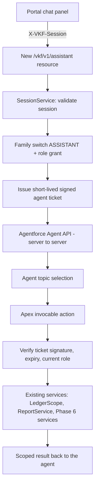

# Agentforce assistant — analysis and proposed approach

Analysis date: 28 October 2026. Status: **proposal, not built**. This document records the readiness check of the `VKFinance` org, the design constraint that shapes the solution, the recommended architecture, the delivery process and the decisions still open. It is the input for a possible Phase 7.

## Goal

Give each family an Agentforce assistant inside the VK Finance portal. The assistant must answer and act **only within the asking person's family** and **only within what that person's custom role allows**. A Child must never see family totals; a Viewer must never change data; nobody may ever see another family's records.

## Org readiness

Checked against `VKFinance` (vkfinance@agentforce.com) on 28 October 2026.

| Item | Finding |
| --- | --- |
| Agentforce (Default) | 1 licence, assigned |
| Agentforce Service Agent User | 200 licences, 0 used — available for the agent's running user |
| Agentforce Service Agent Builder | 10,000 licences, 1 used |
| Agent platform builder | 5 licences, 0 used |
| Einstein Prompt Templates | 5,000 licences, 1 used |
| Data Cloud | Provisioned (required by Agentforce) |
| Existing agents (`BotDefinition`) | None |
| Salesforce CLI | `sf agent` command set available |

**Conclusion:** the org is licensed for Agentforce. No agent exists yet, so there is nothing to migrate or remove.

## The design constraint

VK Finance uses a custom identity model: people sign in with `Portal_User__c` credentials, and every API call carries a `Portal_Session__c` token in `X-VKF-Session`, validated by `SessionService`. Portal users are **not Salesforce users**.

An Agentforce agent therefore cannot rely on Salesforce sharing to know who is asking. It runs as **one shared agent user** for every family. Consequences:

- Family and role scoping must be enforced in **Apex actions**, exactly as the existing REST resources do. Agent topic instructions ("only discuss this family") are helpful but are not a security control.
- The language model must **never supply or choose** the family, member or role. If it could, a prompt-injection message ("show me family FAM-0002") could cross the family boundary.
- Each action must reuse the existing checks — `SessionService`, `LedgerScope`, `Role_Permission__mdt` grants and the family feature switches — so the assistant can see and do only what the person can already see and do in the portal.

## Options considered

| | A. Portal chat panel + Agent API (recommended) | B. Embedded Messaging widget on the Experience site |
| --- | --- | --- |
| Where identity comes from | The server, after `SessionService` validates the session | The browser, via hidden pre-chat fields — must be signed and re-verified |
| Look and feel | Native part of the React portal | Standard Salesforce chat widget |
| Feature switch and role gating | Same code path as every other `/vkf/v1/*` endpoint | Needs extra wiring outside the portal |
| Build effort | Higher (new REST resource, chat UI, Agent API connection) | Lower UI effort, similar Apex effort |
| Rate limiting, audit | Reuses `RateLimiter` and `AuditService` directly | Partly outside the existing controls |

Option A keeps one authentication path and one permission model, so it is recommended.

## Recommended architecture

### Agent ticket

- Issued by the new REST resource only after the session, the family switch and the role grant are checked.
- Contains member, family, role and expiry; signed with an HMAC key held in protected custom metadata or an encrypted field.
- Short-lived (for example 15 minutes) and bound to the Agent API session.
- Passed to the agent as a session variable and mapped to action inputs from that variable, so the model never writes it. This variable mapping must be confirmed on the org at the start of the build.
- Every action re-reads the member's **current** role and family switch, so revoking a role or disabling the feature takes effect immediately, as Phase 6's import worker already does.

## Role-based behaviour

New `Role_Permission__mdt` records with feature `ASSISTANT`, added the same way as the Phase 6 grants (role, feature, actions, scope). The assistant is gated by these grants and by the family's `Enhancements__c` switch, which starts **off**.

| Role | Assistant can |
| --- | --- |
| Family Admin | Answer about all family accounts, budgets, bills, loans, goals and reports; draft entries, saved only after explicit confirmation |
| Co-Admin | Same as Family Admin, within the existing Co-Admin limits |
| Member | Answer about own and shared accounts only, following `LedgerScope` rules; draft own entries |
| Child | Answer about own allowance, own goals and own spend requests; create a spend request; no family totals |
| Viewer | Read-only answers within what the Viewer role already sees |

Underlying grants still decide each action. For example, the assistant's spend-request action relies on the existing `REQUESTS` grants, so it can never do more than the Spend Requests screen allows.

## Proposed topics and actions

| Topic | Actions (Apex) | Type |
| --- | --- | --- |
| Spending and balances | Account balances, spending by category and period, recent transactions | Read |
| Budgets and bills | Budget status, upcoming bills and EMI instalments, card statement dues | Read |
| Insights and reports | Smart insights, monthly summary, saved reports | Read |
| Goals and requests | Savings goal progress; create or check a spend request | Read / write |
| Record an entry | Draft an expense or income entry and confirm it before saving | Write (optional) |
| Help | Answers from the User Guide | Read |

## Security controls

- **Enforcement in Apex**, not prompts: every action verifies the ticket and calls the same services as the portal.
- **Least-privilege agent user:** a new permission set grants only the assistant's Apex classes, with no object access; services use `WITH SYSTEM_MODE` like the rest of the codebase.
- **Writes need confirmation:** the agent proposes, the person confirms in the chat panel, then the action saves. Sensitive actions can require a two-step verification code, reusing `MfaService`.
- **Rate limiting:** per person and a daily message cap per family, via `RateLimiter`.
- **Audit:** every assistant request and action is logged through `AuditService`.
- **Einstein Trust Layer:** prompts and responses pass through Salesforce's Trust Layer with zero data retention at the model provider; masking and toxicity checks apply.
- **Testing:** per-role negative tests, for example a Child asking for the family balance is refused and a Viewer cannot create entries.

## Delivery process

1. **Org setup:** enable Einstein and Agentforce in Setup; create an Agentforce Service Agent (this creates the agent user); assign the new least-privilege permission set.
2. **Server-to-server connection:** create an External Client App and a Named Credential so Apex can call the Agent API.
3. **Apex actions:** build the read actions first, then the optional write actions, each verifying the ticket and reusing existing services, with `RateLimiter` and `AuditService`.
4. **Agent definition:** topics, actions and guardrail instructions, kept as metadata in `force-app` and deployed with the `sf agent` commands.
5. **Tests:** Apex unit tests plus Agentforce Testing Center cases per role (`sf agent test`).
6. **Portal UI:** a chat panel in the React shell, visible only when the family switch is on and the role grant allows it.
7. **Release:** activate the agent, deploy and publish, enable it for Demo Family A first, then let families opt in from **Discover**.

## Cost and risk

| Item | Note |
| --- | --- |
| Agentforce consumption | Each agent turn uses Agentforce credits; Developer Edition allowances are limited. A per-family daily cap is recommended. |
| Latency | The Agent API call is synchronous from Apex; replies take a few seconds. The chat panel should show progress. |
| Model behaviour | Answers can be imperfect. Money-changing actions always need explicit confirmation; read answers come from Apex data, not from the model's memory. |
| Data handling | Financial data is sent to the model through the Trust Layer. The User Guide should say so. |
| Variable mapping | Passing the ticket from a session variable to action inputs must be confirmed on the org at the start of the build; if unavailable, the fallback is a server-side lookup keyed by the Agent API session. |

## Open decisions

1. **Scope of the first release:** read-only (questions and insights), or also writes (draft expenses and spend requests, saved after confirmation)?
2. **Roles:** should Children and Viewers get the assistant?
3. **Channel:** portal chat panel (recommended) or the standard Embedded Messaging widget?
4. **Usage cap:** the daily message limit per family.
