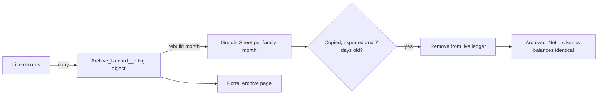

# Archive — big object and Google Sheets

Released 28 October 2026. The org's data storage is 5 MB, which is about 2,500 records at 2 KB each. The archive moves old records out of that storage while keeping them viewable, and keeps a readable copy in the platform owner's Google Drive.

## What happens every night (01:30, "VKF Archive")

`ArchiveJob` starts `ArchiveWorker`, which makes three batch passes, each starting the next. The first two passes go one family at a time; the last goes one month at a time. Chained queueables would hit Developer Edition's five-job limit, so the steps are batch passes instead.

1. **Copy.** New or changed records are written to the `Archive_Record__b` big object. Big objects don't count against data storage.
2. **Google Sheets.** Each family-month that changed is rebuilt as one spreadsheet: `VKFinance Archive / FAM-0001 / FAM-0001 2026-07`. It has one tab per record type, plus that month's audit trail. The result goes to `Archive_Log__c`.
3. **Remove.** Months that are copied, exported to Google, and past the 7-day grace period are removed from the live ledger.



## What is copied

Every family gets a complete copy. In Drive, each family has its own folder (`VKFinance Archive / FAM-0001`) with one spreadsheet per month.

| Record | Sheet tab and month | Removed from Salesforce? |
| --- | --- | --- |
| Transactions | **Transactions**, in the month of the entry (current month included) | Only for months older than the live window, except entries with receipt photos |
| Spend requests | **Spend requests**, by request month | Decided requests in months older than the live window |
| Statement imports | **Statement imports**, by upload month | Finished imports in months older than the live window |
| Ended sessions, read notifications | **Sessions**, **Notifications** | Deleted by the existing cleanup jobs (7 and 60 days) |
| Bill payments, EMI instalments | **Bill payments**, **EMIs**, by due month (upcoming ones in the current month) | No |
| Accounts (with month-end balance), members | **Accounts**, **Members**, as a snapshot | No |
| Bills, loans, budgets, categories, recurring entries, goals, card statements | **Bills**, **Loans**, **Budgets**, **Categories**, **Recurring**, **Goals**, **Card statements**, as a snapshot | No |
| Audit log | **Audit** | No (already a big object) |

The current month's sheet is refreshed every night with whatever changed. Each older month keeps the snapshot taken when its entries last changed. Passwords, salts, two-step keys, recovery codes and session tokens are never copied. The portal **Archive** page lists only months that have been closed into the archive.

**Live window:** the current month plus 3 full previous months. Reports and smart insights read the last three full months directly from the live ledger, so the policy never allows fewer than 3.

## Guarantees

- **Balances never move.** A removed transaction's net effect is added to `Financial_Account__c.Archived_Net__c`. The nightly balance check, card statements and the account statement report all add it back.
- **Closed months.** Once a month is copied, `Family__c.Archived_Through__c` blocks new or edited entries dated on or before that day. This applies to every entry path: the portal, imports and recurring entries.
- **Nothing is removed without a full copy.** Removal requires both the big-object copy and a successful Google copy, unless `Archive_Policy.Default.Google_Copy__c` is turned off. Google's reported row count must match what was sent. A record changed after it was copied stays live; it's copied again and removed after a fresh grace period.
- **Reports:** months older than the live window come from `Monthly_Summary__c`, which is written before any removal. Reports that reach back into archived months show a note saying so.
- **Recycle Bin:** removed rows are emptied from the Recycle Bin straight away, so they stop counting against storage.
- **Who can see what:** the portal **Archive** page (`/vkf/v1/archive`) follows the same visibility rules as Transactions. The Google Sheets are private to the platform owner.

## Settings — `Archive_Policy.Default`

| Field | Default | Meaning |
| --- | --- | --- |
| `Live_Months__c` | 3 | Full months kept live besides the current one (minimum 3) |
| `Grace_Days__c` | 7 | Days between the last copy and removal |
| `Google_Copy__c` | true | Require the Google copy before removal |
| `Folder_Name__c` | VKFinance Archive | Top-level Drive folder |

## Google connection (one-time)

The connection lives in `config/google-archive`, outside `force-app`. Redeploying it resets the secret to a placeholder, so deploy it only once:

```bash
sf project deploy start --target-org VKFinance --metadata-dir config/google-archive
sf org assign permset --target-org VKFinance --name VKF_Google_Archive
```

1. **Google Cloud** (as vksfdc2019@gmail.com):
   - Create a project and enable the Google Sheets API and the Google Drive API.
   - Set the OAuth consent screen to **External** and **In production**. In Testing mode the authorisation expires every 7 days.
   - Add only the `drive.file` scope.
   - Create a **Web application** OAuth client with this redirect URI:
     `https://orgfarm-db588f31ab-dev-ed.develop.my.salesforce.com/services/authcallback/VKF_Google`
2. **Salesforce Setup → Auth. Providers → VKF Google → Edit:** paste the Client ID into **Consumer Key** and the Client Secret into **Consumer Secret**, then save.
3. **Setup → Named Credentials → External Credentials → VKF Google → Principals → Owner → Authenticate:** sign in as vksfdc2019@gmail.com and allow access.

The `drive.file` scope means the app can see only the folders and spreadsheets it created, not the rest of the Drive.

## Operations

- **Status:** query the `Archive_Log__c` rows. Each row shows the status (`Copied` or `Purged`), row counts, the sheet link and the last error.
- **Failures:** a failing family is logged as `ARCHIVE_FAILED` in the audit trail, and the job moves on to the next family. A failed Google copy is retried every night.
- **Run now:** `ArchiveWorker.start();` from anonymous Apex runs exactly what the nightly job runs.
- **Deploy:** `ArchiveJob` is scheduled, so the standard unschedule → deploy → schedule sequence in the README applies.
