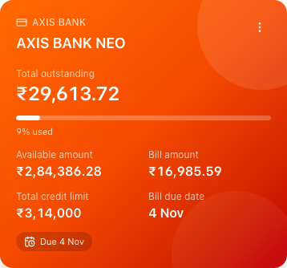

# Credit-card bills

Released to VKFINANCE and published on 29 October 2026.

A recurring bill can be explicitly linked to the credit card it repays. The card account and the account paying it are separate choices; names are never used to match records.

To link an existing bill, open **Bills → Edit → Credit card this bill repays**, choose the card, and save. Keep **Usually paid from** set to the bank, cash or wallet account funding the payment. For the AXIS example, link **AXIS BANK NEO CC** to **AXIS BANK NEO**, keeping **Axis Bank Salary** as the funding account. This step only links the records; it does not post money or change balances.

The card panel shows:

- **Total outstanding:** the card's current ledger balance, including newer purchases.
- **Available amount:** total credit limit minus current outstanding.
- **Bill amount:** the linked occurrence's full billed amount, even after payment.
- **Total credit limit:** the configured limit.
- **Bill due date:** the linked occurrence's actual due date.

A linked bill takes precedence over the computed card statement, including when that statement has a zero amount or a different due date. Without a linked bill, the existing computed-statement behavior remains available. Missing bill data is shown as **No bill recorded** rather than zero.

Overdue/open bills due today take precedence, then bills due later this month. A bill paid this month (or due this month and already paid) stays visible as **Bill paid** ahead of next month's generated bill. Otherwise the next upcoming bill is shown. Partial payments show the amount left; payment does not imply that newer purchases have also been cleared.

## Payments and corrections

Paying the linked bill posts a bank-to-card **Card Payment**, reducing both the bank balance and card liability. It does not create another expense: purchases were already recorded when charged to the card. Existing regular bills retain their expense behavior.

A normal transfer to the card also settles its oldest open linked bill. A payment larger than that bill only allocates the remaining bill amount; the excess remains a card credit and is not automatically applied to future bill occurrences. Both transfer legs retain the bill reference and allocated amount. Editing an allocated payment is blocked; voiding either leg voids both and restores the allocation exactly once.

Only one active bill can link to a card. The selected card must belong to the caller's family and be usable by them. A bill with payments cannot be reassigned or unlinked. A bill paid before this feature was enabled cannot simply be linked retroactively, because that would not convert its historical expenses into card repayments.

The category on a linked bill remains available for reminders; its payments use the card-payment category, not that expense category.

## Release

The backend manifest is `manifest/credit-card-bills.xml`; deploy the backend before the updated portal bundle and publish the Experience Cloud site. The manifest contains the two new fields, changed Apex classes, tests and platform-admin field access. Guest object permissions remain unchanged.

Scheduled VKF jobs reference these classes. Use the existing README deployment procedure, or temporarily allow deployments with Apex jobs in Salesforce Deployment Settings and restore the original setting afterwards. Validation runs must use `--dry-run`; they do not release the feature or link any existing bills.

The existing AXIS bill was explicitly linked after deployment and its returned card summary verified. Its funding account and card balance were preserved. Other existing bills can be linked through the edit screen; the deployment does not match or migrate records by name.

## Verification

The production frontend build, 57 unit tests and all five Chromium fixture tests passed. The browser suite includes the card panel at desktop and 390px phone widths. Salesforce backend dry-run validation passed all 169 local Apex tests without coverage warnings; a separate metadata-only dry run passed the new fields and platform-admin permissions. The temporary deployment setting was restored after validation. The backend and portal were subsequently deployed, the site published, and the existing AXIS bill linked. The release passed all 169 Apex tests. The published bundle and both changed screen assets were checked on the live host; the card service returned the linked bill’s amount and actual due date without changing its balance. Evidence is in [Validation.json](credit-card-bills/Validation.json).

