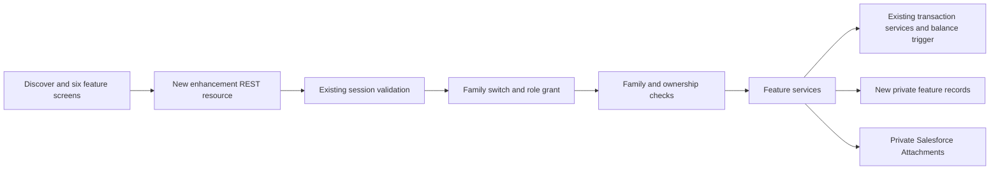
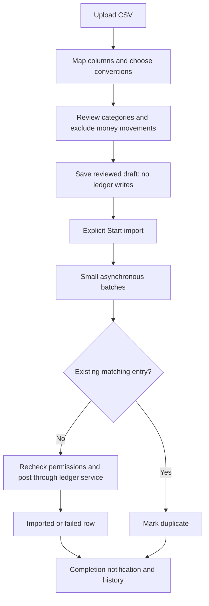
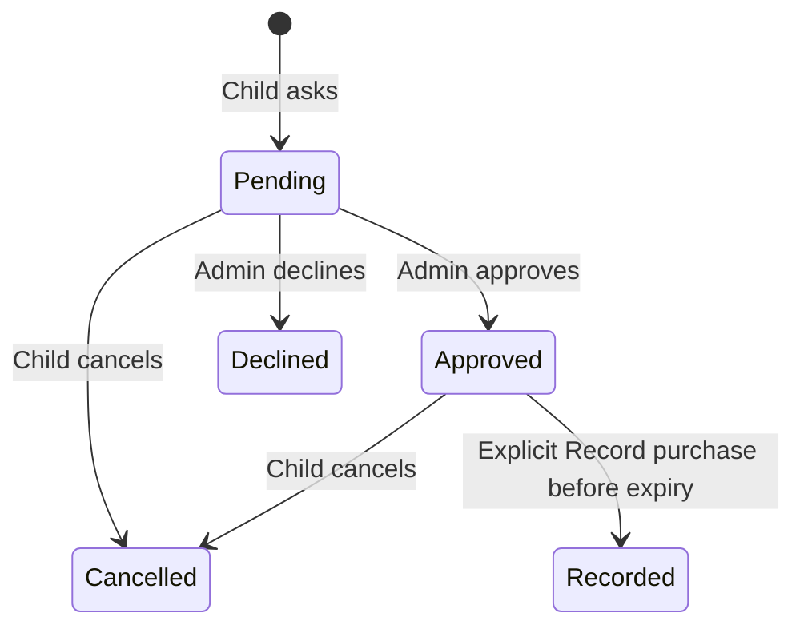
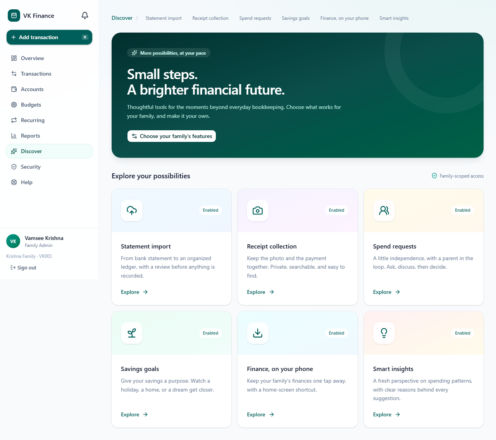
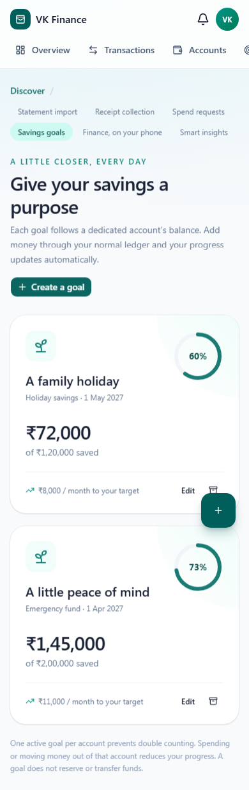

# Phase 6 — Optional enhancements

Implementation and release date: 28 October 2026. Phase 6 has been deployed to the `VKFinance` org and published to the live portal. The backend deployment passed all **150 Apex tests**. Release evidence is recorded in `docs/phase6/Deployment.json`.

All six enhancements start disabled for existing and newly onboarded families. After deployment, a Family Admin opens **Discover → Choose your family’s features**, verifies their password (and MFA code where enabled), and selects the features to enable. The server checks these switches on every new feature request. Disabling a feature retains its records.

| Feature | Delivered behavior | Limits and choices |
| --- | --- | --- |
| Statement import | CSV upload, column matching, explicit date/sign conventions, row review, saved drafts, background import, retry and history | 1 MB CSV, 500 rows/import, three active imports/person, 20 new imports/family/day; three rows per batch execution |
| Receipt photos | Transaction picker, image compression, private upload, protected view/download and deletion | Five photos/transaction; JPEG/PNG/WebP; 350,000 bytes after compression; source photos up to 10 MB/40 megapixels |
| Child spend requests | Child asks, administrator approves/declines, child cancels, notifications and decision history | Up to 20 current pending requests/child; expiry defaults to seven days, maximum 90; actual purchase is recorded explicitly |
| Savings goals | Target/date, automatic account-balance progress, monthly amount needed and archiving | One active goal per account; maximum 50/family; count existing savings or track growth from creation |
| Phone installation | Manifest, icons, browser install flow, scoped service worker and public offline notice | Published host must serve assets at the application path with correct MIME types and allowed worker scope; no offline financial access or queued writes |
| Smart insights | Category spending pace, recurring-expense review, explanations, snooze and dismiss | Minimum spending baseline; current month compared with three complete months; suggestions are scoped to the viewer and never change money or cancel services |

## Architecture and compatibility

The new API is `/services/apexrest/vkf/v1/enhancements/*`, implemented by `VkfEnhancementsResource`. Existing REST endpoints and the existing ledger, authentication and scheduled-job implementations were not changed. UI integration adds lazy routes below `/enhancements` and one permission-controlled **Discover** navigation entry. Existing navigation and money workflows remain available.

Every protected call uses the existing `SessionService`. New role grants are additive custom-metadata records. `EnhancementService` enforces the family switch, action grant and family-scoped record lookup. Services apply additional ownership and account-visibility checks. Guest access adds only the new Apex REST class, with no new object access or public file URLs.

| Object / field | Purpose |
| --- | --- |
| `Family__c.Enhancements__c` | Comma-separated feature keys; blank means all off |
| `Transaction__c.Import_Key__c` | Unique indexed import fingerprint for retry protection |
| `Statement_Import__c` | Import owner/account, state, row counts and async job identity |
| `Statement_Row__c` | Reviewed entry payload, fingerprint, per-row result and error |
| `Transaction_Receipt__c` | Private mapping between transaction and its private Salesforce Attachment; older Files reference fields are retained for compatibility |
| `Spend_Request__c` | Child, approved amount, account/category, expiry, decision and recorded transaction |
| `Savings_Goal__c` | Account, target, baseline, owner and exclusive active-account key |
| `Insight_Preference__c` | Per-person dismissed/snoozed insight state |



## Statement import

The parser supports UTF-8 BOM, commas, semicolons or tabs, escaped quotes and quoted multiline cells. It rejects ragged rows, duplicate/blank headers and oversized files. Users explicitly select date format and debit/credit conventions; a card export can use positive charges rather than positive credits.

Date, description, amount or debit/credit, and optional reference columns are mapped. Users select expense/refund and income categories, review every row and skip unsuitable entries. Potential transfers, card payments and EMI entries are skipped by default: use the existing transfer or loan payment screens so those movements do not become duplicate income/expense. True card refunds can be explicitly classified as Refund.

Saving a review creates a **Draft** and does not change the ledger. **Start import** launches `StatementImportWorker` with a scope of three. Each row has its own savepoint and reuses `TransactionService`; successful rows are marked with source `Import`. The worker rebuilds the requesting member’s identity and checks current role, feature switch and account permissions. Changing a role or disabling access before execution prevents posting.

Duplicate checks use a server-generated family/account/date/type/amount/reference/description fingerprint. They also compare manually recorded entries in the same account with the same date, type and amount plus bank reference, or payee when no reference exists. Matching is intentionally conservative. Two genuine identical purchases may require manual reconciliation and entry; automatic duplicate detection cannot establish identity when the bank supplies no unique reference. A voided imported fingerprint remains reserved; resolve the old ledger entry rather than silently recreating it.



The page polls only while processing and can be left safely. Completed rows are not posted again when failed rows are retried. A system-level batch failure can leave a Processing import requiring operator review; inspect the stored job ID and `AsyncApexJob` before changing state or restarting work. The first version does not offer mass rollback of a completed import; use audited ledger void operations for corrections.

## Private receipt photos

The browser decodes supported image types, respects orientation, limits dimensions, flattens transparency to white and compresses to JPEG. The API independently checks encoded/decoded size and JPEG/PNG/WebP signatures. It serializes uploads per transaction, enforces the five-photo cap and deduplicates repeated bytes.

The server creates an internally owned `Attachment` with `IsPrivate=true`, parented to the private `Transaction_Receipt__c` mapping. This storage choice follows a live-platform finding: the guest execution user could insert a `ContentVersion` but could not query it afterwards, even in system mode. The original upload transaction rolled back cleanly. Switching to a private Attachment avoids that platform restriction without enabling public files or granting guest object access. Earlier Files reference fields remain supported for internally created legacy records.

Storage IDs are omitted from public DTOs. Reading requires a valid VK session, enabled receipt feature and current transaction visibility. Upload/deletion additionally requires transaction edit rights, including the existing Child 24-hour edit limit. Deleting a receipt deletes its attachment and leaves the financial entry intact. See the [Salesforce Attachment field reference](https://developer.salesforce.com/docs/platform/field-reference/references/field-reference/salesforce-field-reference-attachment.html).

**Live-site validation passed.** The two-family pilot verified guest upload, protected download, deduplication, cross-family 404 responses, rejection of anonymous standard attachment download URLs, and removal. An authenticated Chromium session at phone width also uploaded a real browser-generated photo through compression, displayed the protected preview and deleted it. All checks used disposable test families; existing family records were not changed.

## Child requests and savings goals



Approval does not reserve funds or post an expense. **Record purchase** creates exactly the approved expense through the existing transaction service and links it to the request. A locked request row and recorded-state check make retries idempotent. Expiry blocks approval/recording. Existing manual child posting remains available; this optional workflow does not introduce a mandatory approval gate into existing functionality. Recorded entries retain the existing edit/void rules; the request is a history record, not a live payment-status substitute.

Goal progress is `max(0, current account balance − saved baseline)`. Including existing savings sets the baseline to zero; otherwise the creation balance is saved. Withdrawals reduce progress. A goal never moves or reserves money. One active goal/account and a unique account key prevent allocating the same account to multiple goals. Archiving releases the account key without changing the account or ledger.

## Explainable insights

Category pace uses scoped non-void expenses and bill payments, net of refunds. It compares current-month spending with a same-day pace derived from the prior three complete months. The rule waits until day seven, requires a historical monthly baseline of at least 300 currency units, and flags more than 150% of expected pace with an excess of at least 300. A partial first history period can weaken that baseline; the explanation invites review rather than asserting wrongdoing.

Recurring-review cards use active recurring expenses on visible accounts. They normalize weekly/quarterly/yearly amounts to a monthly estimate. They identify a review opportunity, not actual unused-subscription detection. The service returns up to 12 visible, undismissed suggestions; snooze hides the current key for seven days and dismiss for 31 days. Monthly insight keys allow fresh review in a new month. No external AI service receives financial data.

## Installation and offline behavior

PWA assets are produced in the portal’s `dist` directory. Installation is initiated only from the enabled install page, using the runtime application base path. The install flow loads `manifest.json`. Live Salesforce hosting uses a generic binary MIME type for manifests; an isolated live Chromium check confirmed successful manifest parsing with no manifest errors. Setup validates the JSON contents and application URL scope, JavaScript worker response and marked offline response before registration. The worker caches only the public offline notice; a hosting fallback page is rejected. It does not cache online navigation responses, authenticated APIs, SDK requests, receipt photos, script responses or write requests.

The live release check in `scripts/security/check-pwa-live.mjs` verified manifest parsing without browser errors, worker activation at the portal scope, and a cache containing only `vkf-offline.html`. A subsequent authenticated pilot also completed the actual Install page setup at phone width and checked the offline cache. Both browser contexts were isolated, with temporary workers/caches removed afterwards. Native Android/iOS installation still needs a real-device check. Existing browser-managed installations cannot be removed remotely by disabling the family’s install option. See [service-worker registration requirements](https://developer.mozilla.org/en-US/docs/Web/API/ServiceWorkerContainer/register).

## Deployment and maintenance

Deployment is deliberately separate from validation. Review the source and the deployment target first. The backend manifest includes only the new objects/classes/fields/grants and the guest permission-set extension; it does not redeploy existing scheduled-job classes.

```powershell
# Validate backend without saving changes
sf project deploy start --dry-run --manifest manifest/phase6.xml --target-org VKFinance --test-level RunLocalTests --wait 30

# Build portal
Push-Location force-app/main/default/uiBundles/VKFinancePortal
npm.cmd ci
npm.cmd run build
Pop-Location

# Release backend and UI, then publish (completed for the 28 October release)
sf project deploy start --manifest manifest/phase6.xml --target-org VKFinance --test-level RunLocalTests --wait 30
sf project deploy start --source-dir force-app/main/default/uiBundles/VKFinancePortal --target-org VKFinance
sf community publish --name VKFinancePortal --target-org VKFinance

# Optional retention job; preserves existing schedules
sf apex run --target-org VKFinance --file scripts/apex/schedule-phase6.apex
```

`VKF Enhancement Maintenance` runs Sunday at 03:20 in the scheduling user’s time zone. It archives inactive import staging older than 30 days, deletes their reviewed row payloads, retains summary history and ledger fingerprints, and removes old expired insight preferences. It never deletes financial entries, receipt files, goals or approval history. Processing imports are excluded. Monitor failed async jobs, row backlogs, ordinary data storage and Files storage; the Developer Edition environment is not an unlimited production-storage plan.

If rolling back the UI or disabling switches, retain new fields and objects so fingerprints, receipts and history remain intact. Disabling imports is checked again by workers; some rows may already have completed and require ordinary ledger review. A code rollback does not undo financial entries.

## Validation evidence

| Check | Result | Scope |
| --- | --- | --- |
| Salesforce final dry run | **150/150 tests passed**, no component or coverage warnings | Validation deployment `0AfjV000005BGBRSA4`; includes existing tests and the Phase 6 tests; metadata rolled back by dry run |
| Salesforce actual backend deployment | **Succeeded; 150/150 tests passed** | Release deployment `0AfjV000005BI3ZSAW`; metadata saved |
| Frontend unit tests | **32/32 passed** | Includes a regression test for the generic manifest MIME type observed on live Salesforce hosting |
| Browser fixture suite | **4/4 passed** on the final implementation | Desktop/390px phone layout, review-then-start import, approval, snooze, receipt page and local install setup; mock SDK, no live Salesforce data |
| Production build | Passed | TypeScript check and production bundling; the existing large-entry-chunk advisory remains |
| Targeted ESLint | Passed | New frontend feature/API and browser fixture files |
| Live public-site smoke tests | **Passed** | Updated bundle, sign-in page, API session denial, manifest parsing, worker activation and offline-only cache |
| Live authenticated pilot | **6/6 passed; test families cleaned up** | Real guest-triggered import/retry/deduplication, receipt privacy, savings goals, child approvals, scoped insights, and phone-width browser photo/install workflows; see `docs/phase6/Pilot_Checks.json` |
| Per-family activation | **All off; verified** | Three families checked; zero enabled; one maintenance schedule present |
| Native phone installation | **Pending manual device check** | Android/iOS home-screen installation; browser emulation is not claimed as physical installation |

```powershell
Push-Location force-app/main/default/uiBundles/VKFinancePortal
npx.cmd vitest run
npx.cmd eslint src/features/enhancements src/api/enhancements.ts e2e/phase6.spec.ts e2e/phase6Sdk.ts e2e/phase6.vite.config.ts playwright.phase6.config.ts
npx.cmd playwright test --config playwright.phase6.config.ts
Pop-Location
```

The browser test SDK alias exists only in `e2e/phase6.vite.config.ts`; production continues using the Salesforce SDK. Preview images use deterministic fixture data, not live family records.

To repeat the **live** pilot, run `python scripts/security/pilot-phase6.py --browser` from the project root. It creates two uniquely named disposable families, activates features only for them, exercises the real published APIs and browser, then deletes their operational records in `finally`. Password-history records cascade with their temporary members. It requires the internal `VKF_Platform_Admin` permission set, which now includes support/read and cleanup rights on the new objects while keeping secret hash fields excluded. If interrupted before cleanup, inspect `Pilot_Checks.json`; `--resume` verifies the recorded family names and IDs before resetting only those disposable users and retrying. Historical audit events are retained. The temporary guest trace flag used to diagnose the upload issue was removed after the pilot.




