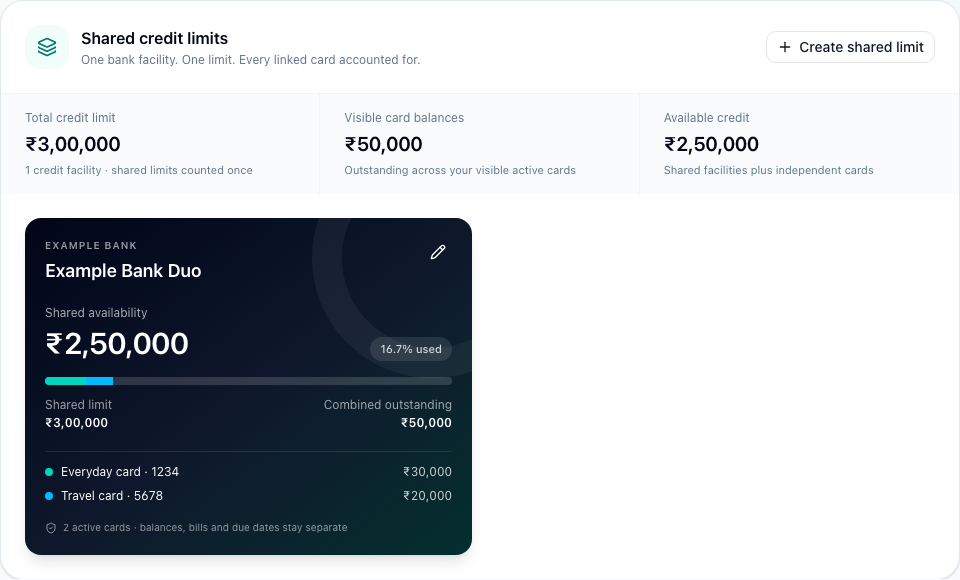
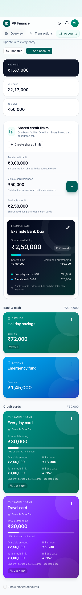

# Shared credit limits

Released and published to VKFINANCE on 29 October 2026.

A credit-limit group represents one bank facility used by multiple cards. Membership is explicit: the application never assumes that cards share a limit because they have the same issuer.

## Using it

1. Open **Accounts → Shared credit limits → Create shared limit**.
2. Give the facility a name, enter its bank and the bank-confirmed shared limit, and select its cards.
3. Review the combined outstanding and availability preview, then save.

Family Admins and Co-Admins can manage groups. Each card belongs to at most one group, and every linked card must belong to the same family. Cards from the same bank can still belong to different facilities.

The overview counts each shared facility once and adds independent cards separately. A facility with a ₹3,00,000 limit and card balances of ₹30,000 and ₹20,000 shows ₹50,000 used and ₹2,50,000 available. Both card tiles show that same shared availability; their outstanding balances, bills, due dates and paid statuses remain separate. Net worth and debt calculations continue using each card's actual balance.

Groups can be renamed, have their limit adjusted, or have cards added and removed. An explicit archive confirmation unlinks all cards and returns them to their saved independent limits. It does not remove accounts or rewrite any financial history. Updating a group's limit never overwrites those independent limits.

## Money and visibility rules

- Shared usage is the sum of positive current balances across all linked cards. Payments, refunds, reversals, interest entries and reconciliation are reflected through the existing ledger; there is no second stored group balance.
- Shared availability is `max(0, limit − usage)`. Usage over the limit is displayed explicitly. Reducing the configured limit below current usage is supported.
- A credit balance on one card does not increase another card's spending power. Such a credit remains visible on its own card. Independent cards retain their existing availability calculation.
- Closed cards remain visible in the facility's membership history; normal account rules require their balance to be zero. Newly closed cards cannot be added to groups.
- A person must be able to see every card in a group before its limit, usage, membership or availability is returned. Otherwise their visible card still shows its own outstanding and bill, but shared details and overview totals are withheld. Hidden-card balances cannot be inferred from shared availability.
- The shared display is calculated from the recorded ledger; bank-only holds and other activity not recorded in the application are not imported automatically. Banks may also apply separate card controls.

## Implementation

`Credit_Limit_Group__c` stores the family, name, issuer, limit, active state and configuration version. `Financial_Account__c.Credit_Limit_Group__c` links cards to it. The original account credit limit is preserved for future unlinking.

`CreditLimitGroupService` computes facility views with bulk queries against current account balances. Overview reads use a bounded number of queries regardless of the number of cards; a 20-card regression verifies exact decimal currency arithmetic and no query-per-card behavior. Balance-only account updates perform no group DML, avoiding a shared counter bottleneck for ordinary ledger traffic.

Family-row locking serializes membership changes. Optimistic version checks reject stale browser edits with HTTP 409. Direct membership and configuration writes advance versions, and triggers reject foreign-family links, non-card membership, or archiving/moving a facility while cards remain linked. Membership updates are atomic and never silently steal cards from another group.

The API extends the existing session-protected account resource:

- `GET /accounts/credit-groups`: visible facility views, deduplicated totals and management permission.
- `POST /accounts/credit-groups`: create a facility with an explicit card ID list.
- `PATCH /accounts/credit-groups/{id}`: save the full selection and configuration using `expectedVersion`.
- `POST /accounts/credit-groups/{id}/archive`: archive and unlink using `expectedVersion`.

Credit-card reports show the facility name per card and count its limit once in headline totals. Restricted totals are omitted. Archive snapshots include the facility configuration, membership and preserved independent limit; related facility changes invalidate the account's archive snapshot.

The new object is private. Guest object permissions are unchanged; every service call still passes through VK session, family and account authorization. Platform-admin access to the new fields is read only because the portal manages membership and configuration together.

## Verification and release

The backend manifest is `manifest/shared-credit-limits.xml`. The portal must be built and deployed after the backend, then the Experience Cloud site published. Existing cards stay independent until a family administrator creates a group.

Run `python3 scripts/security/pilot-shared-credit.py` after publishing to exercise the live guest APIs and phone browser using one disposable family. It covers creation, deduplicated totals, payment/void, over-limit handling, stale edits, browser editing and archiving, then deletes only its uniquely named test family. Credentials remain in memory and existing families are not changed. A failed cleanup is reported explicitly with the exact disposable family identity for operator follow-up.

The release passed all **183 Apex tests**, **63 frontend unit tests**, and **6 browser tests**, plus the production build and theme checks. All five live pilot checks passed, including a real guest-API payment/void cycle and authenticated phone-browser editing. The disposable family and its operational records were removed; existing families were not grouped automatically. The temporary deployment setting was restored and scheduled jobs were preserved.

Release evidence is recorded in [Validation.json](shared-credit-limits/Validation.json) and [Live_Pilot.json](shared-credit-limits/Live_Pilot.json). Preview images use deterministic fixture data; the live phone image uses the disposable pilot family.

