# VK Finance - Detailed Implementation Document

Version 1.2 | 28 October 2026

## 1. Purpose, scope and evidence

VK Finance is a multi-family personal finance platform implemented on Salesforce. Families use a React portal on Experience Cloud to manage accounts, income, expenses, transfers, budgets, bills, loans, recurring entries and reports. Internal Salesforce users operate the VK Finance Console to onboard and support families. Portal members are custom records, rather than individual Salesforce users.

This guide describes the implementation and release reviewed on 28 October 2026. It is intended for developers, solution architects, administrators, testers and support owners. Phase 6 is deployed and published, with all 150 Apex tests passing. Six live pilot checks passed for actual imports, private receipts, goals, approvals, insights and authenticated phone-width browser workflows. Disposable families were removed and existing family switches remain off. Native Android/iOS installation still requires a real device.

| Document control | Value |
| --- | --- |
| Document | VK Finance - Detailed Implementation Document |
| Edition / date | 1.2 / 28 October 2026; Phase 6 enhancements |
| Scope | Repository implementation, metadata, UI, API, security, operations and handover |
| Evidence boundary | Local source review; live org state and current scheduled jobs were not independently verified |
| Outputs | VKFinance_Implementation_Document.docx and VKFinance_Implementation_Document.pdf; Markdown, generator and 12 SVG/PNG diagrams included |
| Existing design | docs/VKFinance_Solution_Blueprint.pdf is the separate solution blueprint |

| Source inventory | Count / setting |
| --- | --- |
| Apex classes / test-annotated classes | 129 / 38 (includes Salesforce template code and test helpers) |
| Apex REST resource classes | 16 |
| Object, event, big-object and custom-metadata definitions | 31 |
| Checked-in custom field definitions | 307 |
| Role permission records | 77 |
| Salesforce source API version | 68.0 in sfdx-project.json |

Source: README.md; sfdx-project.json; force-app/main/default; docs/Security_Checklist.md.

## 2. Business capabilities and boundaries

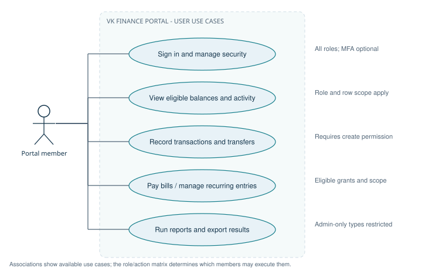

**Figure 1. Portal use-case diagram**

The portal actor represents authorized family roles. Each use case remains subject to the action grants and row scope described in section 7.

Source: routes.tsx; endpoints.ts; Role_Permission metadata; LedgerScope.cls.

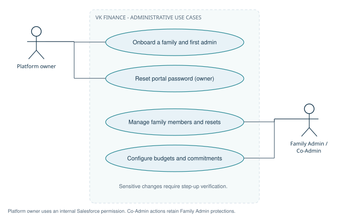

**Figure 2. Administration use-case diagram**

The platform owner operates through an internal Salesforce permission. Family administrators operate within one family and retain step-up and Co-Admin restrictions.

Source: VkfConsoleController.cls; FamilyOnboardingService.cls; MemberService.cls.

| Capability | Implementation | Result for a family |
| --- | --- | --- |
| Identity and membership | AuthService, MemberService, MfaService, FamilyOnboardingService | Invite members, set passwords, manage roles, use authenticator codes and recovery codes. |
| Core ledger | AccountService, CategoryService, TransactionService, TransferService, LedgerBalances | Record movements and maintain explainable balances across assets and liabilities. |
| Planning | BudgetService, DashboardService | Plan monthly spending and compare actuals with category budgets. |
| Commitments | BillService, LoanService, CardStatementService, RecurringService | Track upcoming obligations and record payments through the same ledger. |
| Automation | DailyDuesBatch, DuesProcessor, NotificationService | Post recurring entries, attempt configured auto-pay, update dues and deliver reminders. |
| Insights | ReportService, InsightService | Read 13 reports, export CSV, print, save filters and personalize the overview. |
| Platform operations | VkfConsoleController, scheduled security jobs, AuditService | Onboard families, monitor failures, reconcile balances and control retention. |

The portal is a bookkeeping application. A payment action records ledger entries; the reviewed implementation does not show bank payment rails or a bank-feed integration. Family base currency and time zone are stored, while reminder money formatting explicitly uses the rupee symbol. Foreign-exchange conversion and fully localized automation must not be inferred from those configuration fields.

Family onboarding defaults to INR, Asia/Kolkata and 10 members; the service validates a configured member limit between 1 and 50. Categories are seeded from Default_Category__mdt when a family is created. Template Communities controllers also exist in the repository; they are distinct from the custom VK portal identity flow.

Source: FamilyOnboardingService.cls; DuesProcessor.money; package contents; docs/User_Guide.md.

## 3. Architecture and request lifecycle

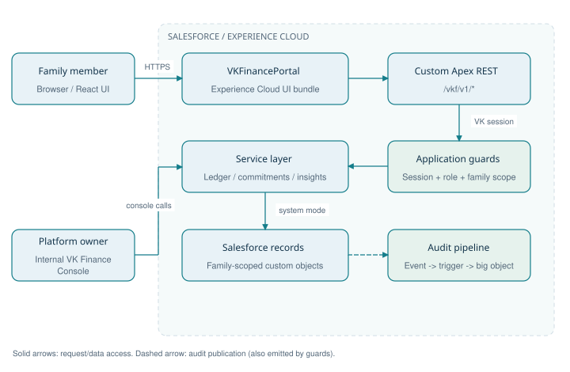

**Figure 3. System architecture and execution boundaries**

Portal REST requests execute as the site guest user. VK identity and application guards authorize the scoped service access; internal console access has a separate Salesforce permission check.

Source: vkfClient.ts; VkfRest.cls; SessionService.cls; AuditService.cls.

| Step / layer | Component | Responsibility |
| --- | --- | --- |
| 1. Browser | React portal / routes.tsx | Render pages, route authenticated users, show actions from returned permissions. |
| 2. Transport | src/api/vkfClient.ts and endpoints.ts | Use Salesforce Data SDK fetch; send JSON and X-VKF-Session. |
| 3. REST boundary | Vkf*Resource and VkfRest | Dispatch verbs and paths, parse bodies, manage savepoints, normalize responses. |
| 4. Identity | SessionService.require -> UserContext | Validate token, user, family, scope and time limits; load current role from records. |
| 5. Authorization | AccessGuard.require + service checks | Enforce role/feature/action, then business and ownership rules. |
| 6. Data scope | FamilyScopedSelector subclasses + LedgerScope | Constrain family queries and narrow visible accounts and transactions. |
| 7. Persistence | Salesforce custom records + triggers | Use explicit system-mode access after application checks; update ledger balances. |
| 8. Audit / response | Audit_Event__e -> Audit_Log__b; VkfRest.respond | Publish audit events, flush deferred session activity, send uncached DTOs. |

The site guest user is the Salesforce execution identity for portal calls. The VK session identifies the actual family member. Services and selectors intentionally use explicit system mode because the guest has no family-data CRUD/FLS access. Consequently, the application-level session, permission and tenant checks are critical security boundaries. Salesforce sharing alone does not implement portal isolation.

Typical write: a resource opens a savepoint, authenticates the VK session, invokes a service, checks a feature action, resolves family-scoped records, applies business validation and saves records. A service returns a DTO rather than serializing unrestricted records. VkfRest sends JSON with Cache-Control: no-store. On failure the REST layer normally rolls back; PortalException.keep() preserves intended security writes such as failed-attempt counters.

Typical read: authenticate, authorize, query the allowed scope, build a DTO and respond. Session activity is deferred until response time so audit big-object reads occur before ordinary DML. New audit reads must preserve this ordering.

Source: VkfRest.cls; SessionService.cls; AccessGuard.cls; FamilyScopedSelector.cls; FinanceDtos.cls; PortalDtos.cls.

## 4. Repository and technology map

| Location / technology | Purpose / declared version |
| --- | --- |
| force-app/main/default/classes | Apex REST, services, selectors, DTOs, jobs and tests. |
| force-app/main/default/objects | Custom objects, custom metadata, platform event and audit big object. |
| force-app/main/default/customMetadata | Role grants, default security policy and category templates. |
| force-app/main/default/uiBundles/VKFinancePortal | React Experience Cloud UI bundle; Node >=22. |
| React / TypeScript / Vite | Declared React ^19.2.0, TypeScript ~5.9.3 and Vite ^7.2.4. |
| Salesforce platform SDK / UI bundle | Both declared ^11.57.2; Data SDK transports custom REST calls. |
| Tailwind / Radix / Zod | Styling, UI primitives and validation; declared ^4.1.17 / ^1.4.3 / ^4.3.5. |
| Vitest / Playwright | Unit and browser test tooling; declared ^4.1.0 / ^1.49.0. |
| lwc/vkfFamilyOnboarding | Internal family onboarding interface. |
| scripts/apex and scripts/security | Scheduling, demo seeding and live black-box security checks. |
| config/hardening | Scoped Salesforce security settings and guest profile changes. |
| docs | User guide, security evidence, demo guidance, blueprint and this implementation guide. |

Versions above are manifest declarations, not a statement about the currently installed environment. The UI package-lock.json records dependency resolution. Root npm scripts primarily target Salesforce LWC development; portal build and Vitest commands must run inside the UI bundle directory.

## 5. Data model and relationships

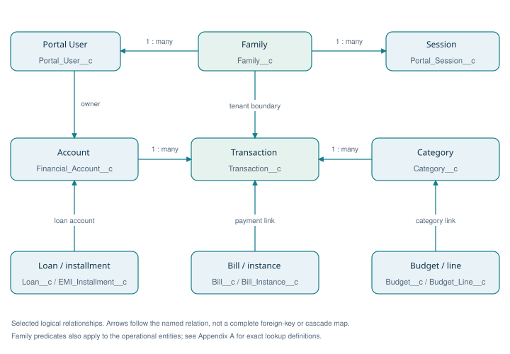

**Figure 4. Core data relationship diagram**

This selected logical view highlights identity, account ownership and ledger links. It omits many tenant links for readability; the field dictionary remains the physical metadata reference.

Source: objects/**/fields/*.field-meta.xml; FamilyScopedSelector.cls.

| Entity | Purpose |
| --- | --- |
| Audit_Event__e | Immediate-publish event transporting audit facts to the writer. |
| Audit_Log__b | Indexed audit history held outside normal custom-object storage. |
| Auth_Token__c | Hashed one-time reset, MFA challenge and recovery-token state. |
| Bill__c | Reusable bill definition, responsible person and payment/reminder configuration. |
| Bill_Instance__c | Dated obligation with amounts due, paid and current status. |
| Budget__c | Monthly family budget header. |
| Budget_Line__c | Category allocation belonging to a budget. |
| Card_Statement__c | Card cycle snapshot, statement amount, minimum payment and due date. |
| Category__c | Family-specific category hierarchy, kinds and system categories. |
| Default_Category__mdt | Category template copied into each family. |
| EMI_Installment__c | Persisted loan installment with principal/interest split and due status. |
| Family__c | Tenant root; family configuration, status, currency, time zone and member cap. |
| Financial_Account__c | Bank, cash, wallet, card, loan and investment balances and ownership. |
| Insight_Preference__c | Phase 6: per-viewer insight dismissal and snooze state. |
| Loan__c | Loan terms, borrower, loan account, EMI and outstanding principal. |
| Monthly_Summary__c | Monthly snapshots supporting older historical trends. |
| Notification__c | Recipient-specific alert, severity, read state and deduplication key. |
| Password_History__c | Previous salted hashes used to enforce password reuse policy. |
| Portal_Session__c | Hashed session token, user/family linkage, scope, activity and revocation. |
| Portal_User__c | Custom portal identity, family membership, role, password state, MFA and dashboard layout. |
| Rate_Limit__c | Hashed client-address or throttle bucket and window counters. |
| Recurring_Rule__c | Recurring transaction configuration, cadence and next-run state. |
| Role_Permission__mdt | Role x feature x action grants plus descriptive scope. |
| Saved_Report__c | Report type and saved filters; private or family shared. |
| Savings_Goal__c | Phase 6: exclusive account allocation, savings baseline, target and target date. |
| Security_Policy__mdt | Default timeouts, password, hashing, throttling and portal URL configuration. |
| Spend_Request__c | Phase 6: child request, administrator decision, expiry and explicitly recorded expense. |
| Statement_Import__c | Phase 6: personal statement staging, async job state, result counters and history. |
| Statement_Row__c | Phase 6: reviewed row JSON, duplicate fingerprint and per-row result; 30-day staging retention. |
| Transaction__c | One ledger movement; linked transfer/payment rows and commitment references. |
| Transaction_Receipt__c | Phase 6: private transaction-to-Attachment mapping, creator, MIME type and byte count; legacy Files reference fields retained. |

### 5.1 Relationship interpretation

Family__c is the application tenant. Most operational records carry a direct family reference so selectors can apply a tenant predicate. Some child records reach the family through their parent. A lookup field alone does not prove that both referenced records belong to the same family: services must resolve and validate every client-supplied reference.

| Relationship | Implementation meaning |
| --- | --- |
| Family -> Portal User -> Session | The session must match the user's current family and active state. |
| Account -> Transaction -> Category / Member | Transactions explain balance changes and attribution; category and member filters are scoped. |
| Transaction <-> counter transaction | Transfer_Group_Id__c and Counter_Transaction__c connect related movements. |
| Budget -> Budget Line -> Category | A month carries planned allocations; actual spending is derived from the ledger. |
| Bill -> Bill Instance -> Transaction | A recurring definition yields dated obligations; payment rows reference the obligation. |
| Loan -> EMI Installment -> Transaction | Terms generate installments; principal and interest rows are linked to payment state. |
| Financial Account -> Card Statement | Statement records are cycle snapshots; payment status is evaluated against ledger credits. |
| Portal User -> Notification / Saved Report | Recipient and owner scope applies inside the family boundary. |

Source: objects/**/fields/*.field-meta.xml; IdentitySelector.cls; CommitmentSelector.cls; TransactionSelector.cls.

## 6. Authentication, sessions and account security

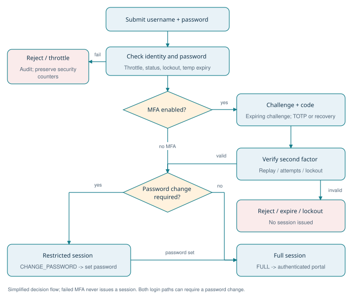

**Figure 5. Sign-in, MFA and first-password flowchart**

MFA verification precedes session creation when enabled. Both password-only and MFA sign-ins can produce a restricted password-change session; setting the personal password issues full access.

Source: AuthService.login, completeMfa, completeLogin and firstLogin; MfaService.cls.

### 6.1 Identity flows

| Flow | Sequence and persisted effects |
| --- | --- |
| Family onboarding | Internal console authorizes the platform owner; creates family, seeded categories and first Family Admin; returns a temporary password once. |
| First sign-in | Validate temporary credentials; create CHANGE_PASSWORD session; require a new password before full portal access. |
| Normal sign-in | Normalize username, apply throttling and lockout, verify salted iterated hash; either issue full session or require MFA challenge completion. |
| MFA sign-in | Validate expiring hashed challenge and TOTP/recovery code; enforce challenge attempts and account lockout; issue full session only after success. |
| Forgot / reset | Return generic forgot-password response, limit reset emails, validate single-use expiring token and apply password policy. |
| Password change | Verify current password, enforce length/history, apply new hash and revoke other devices. |
| Sign-out | Revoke session on the server and clear the browser token. |
| Member removal | Disable sign-in and clear identity secrets while retaining financial history attribution. |

### 6.2 Security policy defaults

| Metadata field | Default | Meaning |
| --- | --- | --- |
| Idle_Timeout_Minutes__c | 30 | Idle session expiration, minutes |
| Absolute_Timeout_Hours__c | 12 | Maximum session lifetime, hours |
| Max_Sessions_Per_User__c | 3 | Concurrent session cap |
| Max_Failed_Logins__c | 5 | Failures before account lockout |
| Lockout_Minutes__c | 30 | Initial lockout duration, minutes; repeat lockouts escalate |
| Throttle_Window_Minutes__c | 15 | Per-username throttle window, minutes |
| Throttle_Max_Attempts__c | 10 | Per-username attempts per window |
| Min_Password_Length__c | 10 | Minimum member password length |
| Min_Admin_Password_Length__c | 12 | Minimum admin password length |
| Password_History_Count__c | 5 | Previous passwords checked |
| Hash_Iterations__c | 3000 | Salted HMAC-SHA256 iteration setting |
| Reset_Token_Minutes__c | 30 | Password-reset token lifetime, minutes |
| Temp_Password_Hours__c | 24 | Temporary password lifetime, hours |
| Session_Retention_Days__c | 7 | Closed session retention, days |
| Portal_Base_Url__c | Environment-specific URL | Email and onboarding destination; change for each environment |
| MFA_Challenge_Minutes__c | 5 | MFA login challenge lifetime, minutes |
| Ip_Max_Failures__c | 30 | Client-address failure cap per window |

Passwords use per-password salt and iterative HMAC-SHA256. Raw session tokens are 256-bit random values and only SHA-256 hashes are persisted. The portal stores the raw token per tab in sessionStorage under vkf.session and sends it in X-VKF-Session. Treat browser script integrity as part of token protection.

SessionService checks active session status, absolute and idle expiration, active user and family, user/session family equality and session scope. A nonblank differing user agent is rejected when a binding hash exists; the code tolerates a missing user-agent header. This is a supplemental check, not a cryptographic device binding.

### 6.3 MFA, recovery and step-up

MfaService implements RFC 6238 authenticator codes, a 30-second period, one window of clock drift and replay protection. The secret is stored in an encrypted field. Setup is confirmed by a valid code. Ten single-use recovery codes are provided; persisted verification state is hashed. Login challenges expire and allow five attempts, with wrong codes also contributing to account lockout.

Sensitive role/status changes, administrative password and MFA resets, MFA disable and recovery-code renewal require step-up verification: current password and, where enabled, an authenticator or recovery code. Failures count toward lockout; lockout revokes sessions. Family-admin MFA reset cannot target the caller or another family. The existing runbook describes platform-owner recovery for a locked-out Family Admin.

Source: AuthService.cls; PasswordService.cls; TokenService.cls; SessionService.cls; MfaService.cls; AccountSecurityService.cls; Security_Policy.Default metadata; src/api/vkfClient.ts.

## 7. Authorization and family isolation

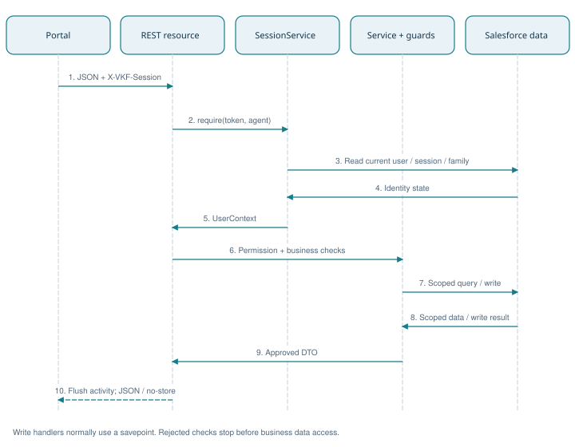

**Figure 6. Protected API request sequence**

The current user and family are resolved before business access. Service permissions and family-scoped selectors determine authorization; safe response construction and deferred activity updates complete the request.

Source: Vkf*Resource.cls; SessionService.require; AccessGuard.cls; VkfRest.respond.

AccessGuard loads Role_Permission__mdt once into a transaction-local map keyed by Role__c + "|" + Feature__c. Actions__c is split on commas, trimmed and uppercased. can() denies a missing grant; require() audits ACCESS_DENIED and throws NOT_AUTHORIZED. permissionsFor() returns sorted FEATURE:ACTION values for UI visibility. Services use uppercase action constants.

Scope__c is not read by AccessGuard. It describes intended scope in metadata; it does not automatically enforce ownership or family visibility. Selectors and service rules implement that scope. Changing a Scope__c value alone does not change record access.

### 7.1 Exact role/action matrix

Cells below are generated from the checked-in role metadata. A dash means no metadata record or no granted actions. Additional service restrictions continue to apply even when an action is listed. Abbreviations: FA = Family Admin; CA = Co-Admin.

| Feature | FA | CA | Member | Child | Viewer |
| --- | --- | --- | --- | --- | --- |
| ACCOUNTS | READ, CREATE, EDIT | READ, CREATE, EDIT | READ, CREATE, EDIT | READ | - |
| BILLS | READ, CREATE, EDIT, PAY | READ, CREATE, EDIT, PAY | READ, PAY | - | READ |
| BUDGETS | READ, CREATE, EDIT | READ, CREATE, EDIT | READ | - | READ |
| CATEGORIES | READ, CREATE, EDIT | READ | READ | READ | READ |
| DASHBOARD | READ | READ | READ | READ | READ |
| ENHANCEMENTS | READ, EDIT | READ | READ | READ | READ |
| GOALS | READ, CREATE, EDIT, DELETE | READ, CREATE, EDIT, DELETE | READ, CREATE, EDIT, DELETE | READ, CREATE, EDIT, DELETE | READ |
| IMPORTS | READ, CREATE | READ, CREATE | READ, CREATE | - | - |
| INSIGHTS | READ | READ | READ | READ | READ |
| LOANS | READ, CREATE, EDIT, PAY | READ, CREATE, EDIT, PAY | READ | - | READ |
| MEMBERS | READ, CREATE, EDIT | READ, CREATE, EDIT | READ | READ | READ |
| MEMBER_SECURITY | EDIT | EDIT | - | - | - |
| NOTIFICATIONS | READ | READ | READ | READ | READ |
| RECEIPTS | READ, CREATE, DELETE | READ, CREATE, DELETE | READ, CREATE, DELETE | READ, CREATE, DELETE | READ |
| RECURRING | READ, CREATE, EDIT | READ, CREATE, EDIT | READ, CREATE, EDIT | - | - |
| REPORTS | READ, CREATE | READ, CREATE | READ, CREATE | READ, CREATE | READ |
| REQUESTS | READ, APPROVE | READ, APPROVE | - | READ, CREATE, CANCEL | - |
| TRANSACTIONS | READ, CREATE, EDIT, DELETE | READ, CREATE, EDIT, DELETE | READ, CREATE, EDIT, DELETE | READ, CREATE, EDIT | READ |

### 7.2 Row-level rules

| Role / concern | Actual scope rule |
| --- | --- |
| Family Admin / Co-Admin | Whole-family ledger visibility. Co-Admin member administration has additional protections around Family Admins. |
| Member | Own and family-shared accounts; can manage own account settings; may edit own eligible transactions. |
| Child | Own accounts; own non-void transaction edits only within 24 hours of CreatedDate. |
| Viewer | Read only; whole-family scope when Viewer_Scope__c = Family; otherwise own-account scope. No posting or account use. |
| Transaction visibility | Whole-family scope OR attributed to caller OR held on a visible account. |
| Transfer destination | Any active account in the same family can receive funds; source use is restricted. This supports pocket money to a child's wallet. |
| Cross-family record IDs | Family-scoped lookup returns NOT_FOUND/404 and can audit CROSS_FAMILY_ATTEMPT. |
| Notifications | Family and Recipient__c must match the caller. Admins do not receive a family-wide notification feed. |

### 7.3 FA_NOTIFICATIONS worked example

Role_Permission.FA_NOTIFICATIONS.md-meta.xml grants Family Admin the NOTIFICATIONS feature with the READ action and Scope__c = OWN. NotificationService.feed() requires NOTIFICATIONS:READ and reads the caller's latest 30 alerts and unread count. markRead() uses the same READ grant, then filters by family and recipient; an empty ids array means mark the caller's unread alerts read, capped at 2,000 in that branch. No separate EDIT grant is required by this implementation.

When adding a protected feature, create the intended role grants, call AccessGuard in the service, resolve IDs through scoped selectors, enforce row-level business rules and return a safe DTO. Client route guards help navigation; server checks enforce access.

Source: AccessGuard.cls; LedgerScope.cls; FamilyScopedSelector.cls; MemberService.cls; NotificationService.cls; Role_Permission.FA_NOTIFICATIONS.md-meta.xml.

## 8. Ledger and planning implementation

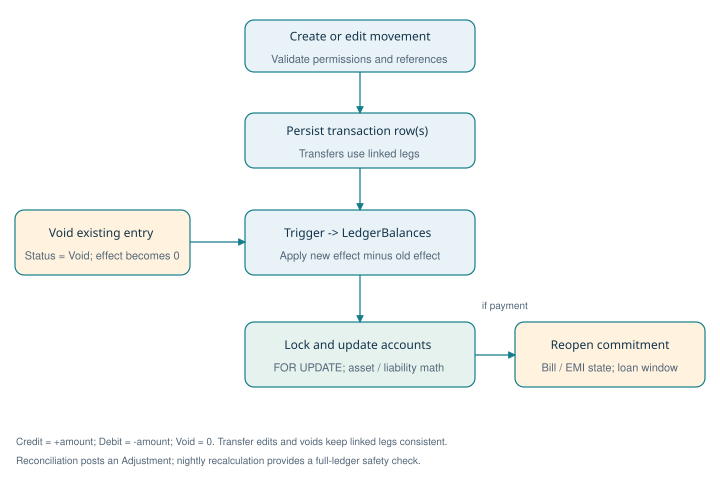

**Figure 7. Ledger posting, balance update and void flowchart**

Posting and voiding pass through the transaction trigger. Delta math updates locked accounts; payment reversals also restore the corresponding commitment state.

Source: TransactionService.cls; TransactionTrigger.trigger; LedgerBalances.cls; LoanService.afterVoid.

### 8.1 Balance mechanics

TransactionTrigger invokes LedgerBalances to apply the difference between old and new net effects. Credit contributes +amount, Debit contributes -amount, and Void contributes zero. The handler locks affected accounts FOR UPDATE before updating balances. Incremental deltas keep posting cost independent of total ledger history; recalculate() is the full-ledger recovery path.

| Account / operation | Rule | Example |
| --- | --- | --- |
| Asset balance | Opening balance + net ledger effect | Bank starts at INR 10,000; an expense debit of INR 1,000 leaves INR 9,000. |
| Liability balance | Opening amount owed - net ledger effect | Card owes INR 5,000; a purchase debit of INR 1,000 increases owed balance to INR 6,000. |
| Transfer | Source debit + target credit, linked by group and counter IDs | Bank to wallet changes account balances, without increasing family income or spending. |
| Credit-card payment | Linked Card Payment rows | Bank debit and card credit reduce cash and card debt; purchase expense was already recognized. |
| Reconcile to statement | Post an Adjustment explaining the difference | Use Accounts -> Match to statement instead of manually overwriting the current balance. |
| Void | Set status to Void; trigger removes the prior net effect | History remains visible while balances and commitment status are corrected. |

### 8.2 Transactions and validation

Manual entry accepts Income, Expense and Refund; transfers use TransferService. Services validate account usability, category type, member attribution, amount and transaction date. Admins can attribute entries to a family member; other roles can post only for themselves. Transfer source must be a usable non-liability account, source and destination must differ, and destination must be active and in the family. General transfers reject Loan targets; loan payments use LoanService.

Transaction edits update both transfer legs together for supported fields. Changing a transfer's accounts requires voiding and recreating it. Bill and EMI payments cannot be edited; void them and pay again. Voiding linked payment groups restores bill or installment state and rebuilds the loan window as needed.

The transaction list supports month or from/to dates, types, account, category including children, member where allowed, search text and optional void records. Default page size is 50 with a maximum of 200. Pagination uses a date/name cursor; aggregate totals are returned on the initial page. This avoids deep OFFSET pagination.

### 8.3 Categories, budgets and dashboard

Category templates are copied into family-specific records. Parent-child categories support drilldown and aggregation, while system categories identify transfers and card payments. A monthly Budget__c groups Budget_Line__c planned category amounts. BudgetService computes actuals from ledger activity and supports copying the prior month. DashboardService combines scoped balances and monthly figures; InsightService stores each person's overview layout.

Source: LedgerBalances.cls; TransactionTrigger.trigger; TransactionService.cls; TransferService.cls; AccountService.cls; CategoryService.cls; BudgetService.cls; DashboardService.cls.

## 9. Bills, loans, cards and recurring commitments

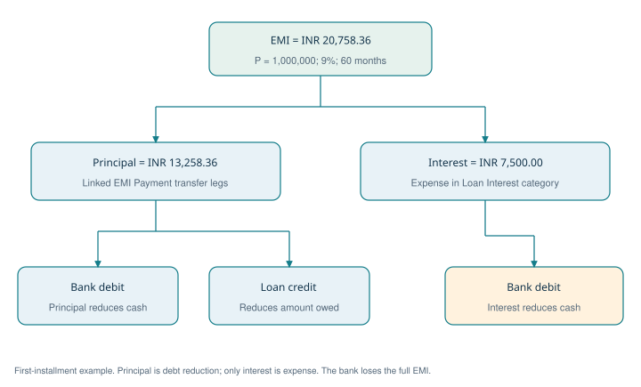

**Figure 8. EMI payment accounting diagram**

One installment becomes a principal pair plus an interest expense when interest is positive. This preserves debt reduction separately from family spending.

Source: EmiCalculator.cls; LoanService.payEmi and principalLegs.

| Module | State / calculation | Payment and reversal behavior |
| --- | --- | --- |
| Bills | Bill definition produces dated Bill_Instance records; refresh derives due/overdue state and tracks amount due/paid. | Pay creates Bill Payment ledger activity; skip is explicit; voiding payment reopens the corresponding obligation. |
| Loans / EMIs | EmiCalculator computes amortization; only the next 12 open installments are persisted, plus historical paid records. | EMI splits principal transfer legs from interest expense. Payment updates paid count and rebuilds the next installment window. |
| Loan prepayment | Principal-only payment, no greater than outstanding. | EMI remains the same; remaining tenure shortens. Ledger reversal rebuilds future installments. |
| Cards | Statements snapshot cycle-end owed amount, minimum due and due date; unique cycle keys prevent duplicate creation. | Card Payment/Adjustment credits determine payment progress. The card is paid through linked ledger movements. |
| Recurring entries | Weekly, Monthly, Quarterly or Yearly; next-run date advances after post/skip; MAX_CATCH_UP = 3. | Configured auto-post reuses normal transaction/transfer services; manual confirmation can post or skip. |

### 9.1 EMI calculation and accounting example

For principal P, monthly rate r = annual percentage / 1200 and tenure n, EMI = P*r*(1+r)^n / ((1+r)^n - 1). Zero-rate loans use P/n. Each period rounds interest to two decimal places, principal is EMI minus interest, and the final payment absorbs the remaining principal. An EMI too small to repay the balance is rejected.

For INR 1,000,000 at 9% for 60 months, the calculated EMI is approximately INR 20,758.36. First-month interest is INR 7,500.00 and principal is INR 13,258.36. LoanService records the principal as linked movements from the paying account to the loan account and the interest as an Expense from the paying account. This keeps principal reduction separate from expense reporting. The full computed schedule is capped at 600 rows in current service calls.

### 9.2 Daily processing and reruns

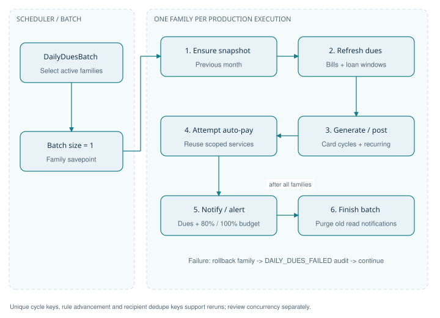

**Figure 9. Daily automation activity diagram**

Batch execution isolates each family. The finish-stage notification purge runs after the batch; a family failure is rolled back and audited without cancelling other families.

Source: DailyDuesBatch.cls; DuesProcessor.run; NotificationService.cls.

DuesProcessor first ensures the prior monthly snapshot, refreshes bill instances and loan windows, generates card statements and processes recurring rules. It then attempts configured bill/EMI auto-pay, sends bill/EMI/card reminders and evaluates budget thresholds. Automation builds a real member context through SystemContext so the reused services still apply role and scope checks.

DailyDuesBatch uses one family per production batch execution. Each family has a savepoint; an exception rolls back that family's work and emits DAILY_DUES_FAILED. Completion purges read notifications beyond retention. Unique keys, due-state advancement and notification dedupe keys support reruns; they should not be interpreted as a general distributed exactly-once guarantee for every concurrent payment request.

Bill/EMI reminder buckets include 7, 3, 1 and 0 days; card reminders inspect a five-day horizon. Budget notifications go to admins at 80% and 100%. Dedupe keys include family, event identity and recipient. Auto-pay records bookkeeping movements inside Salesforce; it does not initiate an external bank payment.

Source: BillService.cls; LoanService.cls; EmiCalculator.cls; CardStatementService.cls; RecurringService.cls; DuesProcessor.cls; DailyDuesBatch.cls; SystemContext.cls.

## 10. Reports, snapshots and export

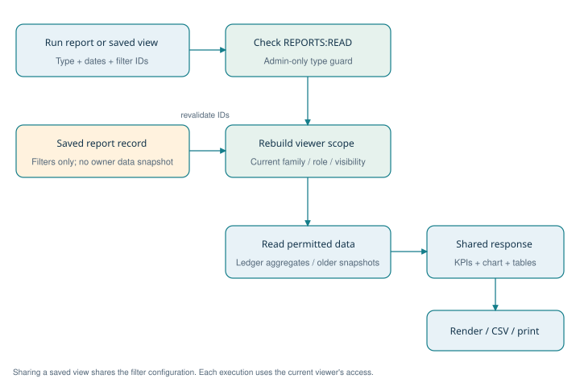

**Figure 10. Report execution and saved-filter data flow**

A shared report definition never grants the owner's data access. Filters are resolved again and the report is read using the current viewer's family and visibility.

Source: ReportService.cls; InsightService.cls; ReportView.tsx.

ReportService uses a shared response shape: type/title/subtitle, date range, KPI list, one chart, a primary table, optional detail table, note and drilldown information. ReportView renders that contract across report types. Default period is the selected/current month; the service rejects reversed ranges and spans beyond MAX_DAYS = 1,100. Member, category and account filters are revalidated against the caller's scope.

| Type | Report | Access | Purpose |
| --- | --- | --- | --- |
| summary | Monthly summary | REPORTS:READ + scope | Income, spending and net position. |
| category | Category spending | REPORTS:READ + scope | Category and subcategory drilldown. |
| members | Member comparison | Admins only | Family member attribution and comparison. |
| trend | Spending / income trend | REPORTS:READ + scope | Historical month series, using snapshots for older months where applicable. |
| budget | Budget versus actual | REPORTS:READ + scope | Planned allocations compared with ledger actuals. |
| forecast | Cash-flow forecast | Admins only | Upcoming commitments and available liquid funds. |
| account | Account view | REPORTS:READ + scope | Scoped account activity and balances. |
| cards | Credit cards | REPORTS:READ + scope | Card balances, utilization and payment view. |
| loans | Loan view | REPORTS:READ + scope | Outstanding amounts and installment context. |
| bills | Bills view | Admins only | Family obligations and payment state. |
| modes | Payment modes | REPORTS:READ + scope | Spending grouped by payment mode. |
| annual | Annual summary | Admins only | Family year-level comparison. |
| security | Security activity | Admins only | Family security/audit view. |

Saved_Report__c stores report type and filter configuration rather than a frozen data extract. Sharing a saved report does not share the owner's access: the report is rerun using the viewer's current scope. Dashboard widget order/visibility is saved in Portal_User__c.Dashboard_Layout__c. Monthly_Summary__c snapshots support trend months older than three; the daily job ensures the previous month exists.

CSV export and browser print are portal capabilities. The Print workflow can be saved as PDF by the browser. These are separate from the DOCX/PDF project documentation generated with this guide.

Source: ReportService.cls; InsightService.cls; src/features/reports/ReportView.tsx; src/api/reportTypes.ts.

## 11. Portal implementation and API contract

### 11.1 Frontend organization

| Area | Implementation |
| --- | --- |
| Routing | routes.tsx: public login/forgot; reset-password and first-login; authenticated AppLayout with feature guards. |
| Lazy loading | Pages beyond the overview are loaded on demand using React.lazy. |
| Authentication state | AuthContext, RouteGuards and SessionTimeout coordinate session state and sign-in transitions. |
| Shared finance state | LedgerContext and typed API DTOs support common account/category/transaction interactions. |
| API adapter | vkfClient caches Data SDK initialization, attaches session header and converts errors to ApiError. |
| Session expiration | A 401 SESSION_EXPIRED with a token clears storage and dispatches vkf:session-expired. |
| Feature pages | Accounts, transactions, categories, budgets, bills, loans, recurring, family, profile/security, reports and help. |
| UI system | Tailwind styling, shared UI primitives, finance components, charts, QR and OTP controls. |

### 11.2 REST resource map

Base path: /services/apexrest/vkf/v1. The mappings below are read directly from Apex annotations. Wildcard resources dispatch child paths internally. Most protected resources require a full session; login/reset/MFA and ping have flow-specific authentication rules.

| Resource class | Mapping (after /services/apexrest) | HTTP handlers |
| --- | --- | --- |
| VkfAccountsResource | /vkf/v1/accounts/* | Get, Post, Patch |
| VkfAuthResource | /vkf/v1/auth/* | Post, Get, Put |
| VkfBillsResource | /vkf/v1/bills/* | Get, Post, Patch |
| VkfBudgetsResource | /vkf/v1/budgets/* | Get, Put, Post |
| VkfCategoriesResource | /vkf/v1/categories/* | Get, Post, Patch |
| VkfDashboardResource | /vkf/v1/dashboard/* | Get |
| VkfEnhancementsResource | /vkf/v1/enhancements/* | Get, Post, Patch, Delete |
| VkfFamilyResource | /vkf/v1/family/* | Get, Post, Patch, Delete |
| VkfLoansResource | /vkf/v1/loans/* | Get, Post, Patch |
| VkfNotificationsResource | /vkf/v1/notifications/* | Get, Post |
| VkfPingResource | /vkf/v1/ping | Get |
| VkfProfileResource | /vkf/v1/profile/* | Get, Post, Delete |
| VkfRecurringResource | /vkf/v1/recurring/* | Get, Post, Patch |
| VkfReportsResource | /vkf/v1/reports/* | Get, Post, Put, Delete |
| VkfTransactionsResource | /vkf/v1/transactions/* | Get, Post, Patch, Delete |
| VkfTransfersResource | /vkf/v1/transfers/* | Post |

### 11.3 Client operation catalog

The following operations are extracted from endpoints.ts. {id} represents a URL-encoded client identifier or path parameter; query expressions are omitted from the path column. Request fields and return types are defined in src/api/types.ts, financeTypes.ts, commitmentTypes.ts and reportTypes.ts. Server handlers remain authoritative.

| Client operation | Verb | Path |
| --- | --- | --- |
| authApi.login | POST | /auth/login |
| authApi.verifyMfa | POST | /auth/mfa |
| authApi.logout | POST | /auth/logout |
| authApi.session | GET | /auth/session |
| authApi.firstLogin | POST | /auth/first-login |
| authApi.changePassword | PUT | /auth/password |
| authApi.forgot | POST | /auth/forgot |
| authApi.reset | POST | /auth/reset |
| profileApi.me | GET | /profile/me |
| profileApi.sessions | GET | /profile/sessions |
| profileApi.signOutOtherDevices | DELETE | /profile/sessions |
| profileApi.signOutDevice | DELETE | /profile/sessions/{id} |
| profileApi.security | GET | /profile/security |
| profileApi.startMfa | POST | /profile/mfa/setup |
| profileApi.confirmMfa | POST | /profile/mfa/confirm |
| profileApi.disableMfa | POST | /profile/mfa/disable |
| profileApi.renewRecoveryCodes | POST | /profile/mfa/recovery-codes |
| familyApi.members | GET | /family/members |
| familyApi.addMember | POST | /family/members |
| familyApi.updateMember | PATCH | /family/members/{id} |
| familyApi.unlock | POST | /family/members/{id}/unlock |
| familyApi.resetPassword | POST | /family/members/{id}/reset-password |
| familyApi.resetMfa | POST | /family/members/{id}/reset-mfa |
| familyApi.signOutMember | DELETE | /family/members/{id}/sessions |
| financeApi.accounts | GET | /accounts |
| financeApi.transferTargets | GET | /accounts/targets |
| financeApi.createAccount | POST | /accounts |
| financeApi.updateAccount | PATCH | /accounts/{id} |
| financeApi.reconcile | POST | /accounts/{id}/reconcile |
| financeApi.categories | GET | /categories |
| financeApi.createCategory | POST | /categories |
| financeApi.updateCategory | PATCH | /categories/{id} |
| financeApi.transactions | GET | /transactions |
| financeApi.createEntry | POST | /transactions |
| financeApi.updateTransaction | PATCH | /transactions/{id} |
| financeApi.voidTransaction | DELETE | /transactions/{id} |
| financeApi.transfer | POST | /transfers |
| financeApi.budget | GET | /budgets/{id} |
| financeApi.saveBudget | PUT | /budgets/{id} |
| financeApi.copyBudget | POST | /budgets/{id}/copy-previous |
| financeApi.dashboard | GET | /dashboard |
| commitmentApi.bills | GET | /bills |
| commitmentApi.createBill | POST | /bills |
| commitmentApi.updateBill | PATCH | /bills/{id} |
| commitmentApi.payBill | POST | /bills/instances/{id}/pay |
| commitmentApi.skipBill | POST | /bills/instances/{id}/skip |
| commitmentApi.loans | GET | /loans |
| commitmentApi.schedule | GET | /loans/{id}/schedule |
| commitmentApi.createLoan | POST | /loans |
| commitmentApi.updateLoan | PATCH | /loans/{id} |
| commitmentApi.payEmi | POST | /loans/{id}/pay |
| commitmentApi.prepay | POST | /loans/{id}/prepay |
| commitmentApi.statements | GET | /accounts/{id}/statements |
| commitmentApi.rules | GET | /recurring |
| commitmentApi.createRule | POST | /recurring |
| commitmentApi.updateRule | PATCH | /recurring/{id} |
| commitmentApi.postRule | POST | /recurring/{id}/{post\|skip} |
| commitmentApi.notifications | GET | /notifications |
| commitmentApi.markRead | POST | /notifications/read |
| reportApi.run | GET | /reports/{id} |
| reportApi.saved | GET | /reports/saved |
| reportApi.save | POST | /reports/saved |
| reportApi.remove | DELETE | /reports/saved/{id} |
| reportApi.layout | GET | /reports/layout |
| reportApi.saveLayout | PUT | /reports/layout |

### 11.4 Errors, status codes and payloads

| HTTP status | Application codes / meaning |
| --- | --- |
| 200 / 201 / 204 | Successful response, created entity or empty success according to handler. |
| 400 | BAD_REQUEST, MFA_EXPIRED; malformed JSON object or invalid request. |
| 401 | INVALID_CREDENTIALS or SESSION_EXPIRED. |
| 403 | NOT_AUTHORIZED, PASSWORD_CHANGE_REQUIRED or LOCKED. |
| 404 | NOT_FOUND, including out-of-family record references. |
| 409 | CONFLICT, such as an already closed commitment. |
| 422 | VALIDATION or INVALID_CODE. |
| 429 | THROTTLED. |
| 500 | UNEXPECTED; generic client message, diagnostics restricted to server logging. |

```text
Request header: X-VKF-Session: <raw session token>
Content-Type: application/json

Example transaction body (use real in-scope record IDs):
{
  "type": "Expense", "accountId": "<account-id>",
  "categoryId": "<expense-category-id>", "amount": 1250,
  "date": "2026-10-28", "notes": "Groceries"
}

Error contract:
{"code":"NOT_AUTHORIZED","errors":["You don't have access to do that."]}
```

Source: src/routes.tsx; src/api/endpoints.ts; src/api/vkfClient.ts; Vkf*Resource.cls; VkfRest.cls; PortalException.cls.

## 12. Audit, scheduled jobs and retention

AuditService publishes Audit_Event__e immediately. AuditEventTrigger delegates to AuditLogWriter, which persists Audit_Log__b. Immediate publishing means security evidence can survive a rolled-back business transaction; an event is evidence of the logged action/attempt and must be interpreted with its outcome. AuditService is intentionally pinned to API 66.0 in this repository because of guest platform-event access behavior documented by the project.

| Job | Schedule expression | Purpose |
| --- | --- | --- |
| VKF Session Cleanup | 0 0 * * * ? | Hourly: expire stale sessions and remove old closed sessions/spent token state. |
| VKF Balance Reconcile | 0 0 2 * * ? | Daily 02:00: compare balances with ledger, correct drift and audit changes. |
| VKF Daily Dues | 0 0 6 * * ? | Daily 06:00: commitments, recurring entries, reminders and monthly snapshots. |
| VKF Retention Purge | 0 0 4 ? * SUN | Sunday 04:00: remove stale notifications, tokens, password history and rate windows. |
| VKF Security Digest | 0 0 7 ? * MON | Monday 07:00: email a security/operations summary to the scheduling user. |

The schedule script retains jobs whose names already exist, so rerunning it does not update an existing cron expression. When changing schedules, inspect and replace the intended existing jobs. Cron expressions do not embed a family time zone; verify the scheduling Salesforce user's time zone and NextFireTime. Family.Time_Zone__c does not by itself prove family-specific execution times.

| Record / concern | Retention or operational behavior |
| --- | --- |
| Closed sessions | Default seven days; hourly cleanup also marks stale active sessions expired. |
| Read notifications | Older than 60 days are purged; unread notifications are not covered by this read-only deletion rule. |
| Auth tokens | Weekly purge removes used or expired tokens older than one day, with a 5,000-row query cap. |
| Password history | Retain configured history depth; remove surplus and history belonging to removed members. |
| Rate limits | Weekly purge deletes windows older than one day, capped at 5,000 per query. |
| Financial ledger / audit | No general ledger or audit deletion policy is established by these housekeeping rules. Define archival separately if required. |

The existing security checklist reports a Developer Edition constraint of 5 MB normal data storage and 15 external emails/day; treat these as the recorded environment assumptions, not a newly checked quota. Monitor actual org storage and email limits before adding families. Several purge paths have row caps and the recurring catch-up has a cap, so review backlogs after downtime or growth.

Source: AuditService.cls and metadata; AuditEventTrigger.trigger; AuditLogWriter.cls; schedule-jobs.apex; SessionService.cleanup; RetentionPurgeJob.cls; docs/Security_Checklist.md.

## 13. Build, configuration and deployment runbook

### 13.1 Prerequisites and environment settings

| Prerequisite | Preparation |
| --- | --- |
| Salesforce access | Use the intended org alias, Experience Cloud site and internal deployment user. This guide follows the repository alias VKFinance. |
| Platform owner | Assign VKF_Platform_Admin permission set for console and administrative scripts. |
| Local tools | Node >=22, npm and Salesforce CLI; authenticated connection to the intended org. |
| Portal configuration | Review Security_Policy.Default.Portal_Base_Url__c and Experience Cloud routing for each environment. |
| Guest API boundary | Preserve VKF_Guest_Api_Access and hardening; do not grant guest family-object CRUD/FLS access. |
| Scheduler | Confirm scheduler identity, time zone and email destination for the security digest. |
| Email and recovery | Verify reset email delivery, portal reset links and owner support procedures before onboarding. |

### 13.2 Build and deploy commands

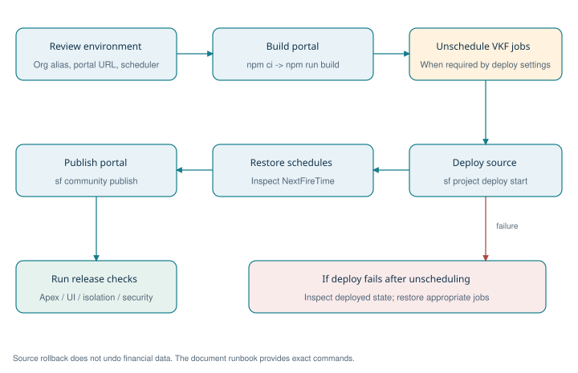

**Figure 11. Deployment and schedule-recovery flowchart**

Build the bundle before source deployment, restore required jobs and publish the portal. If deployment fails after unscheduling, inspect the actual org state before restoring jobs.

Source: README.md; schedule-jobs.apex; unschedule-jobs.apex.

Run commands from the project root in PowerShell. Review the target-org alias before any mutating command. npm ci uses the checked-in portal lockfile. Unscheduling is needed where Salesforce blocks deployments of classes referenced by pending jobs; the repository documents a Deployment Settings alternative. These commands are instructions and were not executed as part of this document task.

```text
# Build portal
Push-Location force-app/main/default/uiBundles/VKFinancePortal
npm ci
npm run build
Pop-Location

# Deploy source, restore schedules and publish the site
sf apex run --target-org VKFinance --file scripts/apex/unschedule-jobs.apex
sf project deploy start --target-org VKFinance --source-dir force-app
sf apex run --target-org VKFinance --file scripts/apex/schedule-jobs.apex
sf community publish --name VKFinancePortal --target-org VKFinance

# Apply the reviewed hardening package
sf project deploy start --target-org VKFinance --metadata-dir config/hardening
```

If deployment fails after jobs are unscheduled, assess the deployed state and restore appropriate schedules using the reviewed script. Publishing and Apex tests are separate steps. Keep a prior known-good source revision and build artifact for recovery; redeploying source does not reverse data mutations or financial entries.

### 13.3 Onboarding and demo preparation

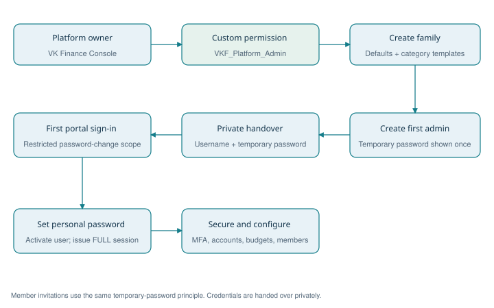

**Figure 12. Family onboarding and first-access workflow**

The platform owner creates the first administrator. Private credential handover leads to a restricted first sign-in, a new password and normal family setup.

Source: VkfConsoleController.onboardFamily; FamilyOnboardingService.cls; AuthService.firstLogin.

| Step | Action / expected result |
| --- | --- |
| 1 | Open VK Finance Console -> Onboard Family as an authorized internal user. |
| 2 | Enter family and first Family Admin details; inspect currency, time zone and member cap. |
| 3 | Share the one-time temporary password privately; first sign-in requires a personal password. |
| 4 | Enable MFA for administrators; save recovery codes; add members and assign minimal roles. |
| 5 | Add accounts with opening balances, confirm category templates and configure budgets/commitments. |
| 6 | For an isolated demo only, use seed-demo-families.apex, seed-demo-finance.apex and seed-demo-commitments.apex (the README says to run the last twice). |

Demo credentials are intentionally not reproduced here. Use the existing Demo_Access.md only in the appropriate trusted environment. Demo scripts change records and are not part of a normal production deployment.

Source: README.md; scripts/apex/*.apex; config/hardening; VKF_Platform_Admin.permissionset-meta.xml; VKF_Guest_Api_Access.permissionset-meta.xml.

## 14. Verification strategy and existing evidence

The figures below are historical claims from docs/Security_Checklist.md dated 28 October 2026. Fresh Phase 6 verification is recorded separately in section 16 and docs/Phase6_Enhancements.md; published-site runtime behavior is not certified by the local and validation-only checks.

| Existing evidence | Recorded result | Interpretation |
| --- | --- | --- |
| Live black-box security checks | 20 / 20 passed | Historical published-site checks of isolation, auth, guest data access and response hygiene. |
| Apex tests | All pass; 93% org-wide coverage | Historical org test run; this guide does not include a newly generated test report. |
| Browser MFA checks | 8 / 8 passed | Historical setup, sign-in and admin reset verification. |
| Code Analyzer security review | 58 findings triaged; no open VK issues reported | Includes deliberate system-mode access and template-code findings; review the original rationale. |
| Salesforce Health Check | 85, improved from 64 | Remaining Salesforce login/configuration choices are listed in the security checklist. |

### 14.1 Test coverage map

| Concern | Representative repository tests | Release expectation |
| --- | --- | --- |
| Identity and password rules | AuthServiceTest, PasswordServiceTest, SessionServiceTest | Reject wrong/expired/revoked credentials and enforce password history and restricted sessions. |
| MFA / security jobs | MfaServiceTest, SecurityJobsTest | Check TOTP vectors, replay, recovery, lockout and housekeeping behavior. |
| Family and finance isolation | FamilyIsolationTest, FinanceIsolationTest | Use another family's IDs on reads and writes; require 404 and audit behavior. |
| Ledger / planning | LedgerServiceTest, PlanningServiceTest | Verify debit/credit/liability math, paired transfers, voids, scope and budget totals. |
| Commitments / automation | CommitmentServiceTest, DuesAutomationTest | Verify payment splits, reopen behavior, reruns, dedupe and due-date changes. |
| REST / console | VkfResourcesTest, VkfLedgerResourcesTest, VkfCommitmentResourcesTest, VkfConsoleControllerTest | Verify dispatch, status codes, safe payloads and internal authorization. |
| Insights | ReportServiceTest | Verify report scope, admin-only types, aggregates and saved-filter behavior. |
| Portal unit / browser tooling | src/api/vkfClient.test.ts; src/lib/finance.test.ts; e2e/ | Run available portal checks; inspect browser paths for affected features. |

```text
# Apex validation
sf apex run test --target-org VKFinance --test-level RunLocalTests --code-coverage --wait 30

# Portal validation
Push-Location force-app/main/default/uiBundles/VKFinancePortal
npx vitest run
npm run build
Pop-Location

# Security static analysis
sf code-analyzer run --workspace force-app/main/default/classes --workspace force-app/main/default/triggers --rule-selector Security

# Live checks require environment-specific test accounts and variables.
# Follow docs/Security_Checklist.md, then run:
node scripts/security/pentest.mjs
```

Release acceptance should include: a fresh login and first-login path; MFA and recovery; a cross-family denial; Member/Child/Viewer restrictions; posting and voiding a transfer; a bill and EMI payment/reversal; budget actuals; report scope; and scheduled-job status. Use dedicated test data and check both UI and API outcomes.

## 15. Troubleshooting, limitations and handover

| Symptom / constraint | Likely cause | Action |
| --- | --- | --- |
| Guest API cannot read family objects | Expected absence of direct guest CRUD/FLS | Use the custom REST route and VK session; preserve application checks. |
| Apex deployment blocked by jobs | Scheduled jobs reference edited classes | Follow unschedule/deploy/reschedule or the reviewed Deployment Settings alternative. |
| Audit read fails after writes | Big-object query ordering restriction documented by project | Perform audit reads before DML; keep session activity deferred. |
| Locked account returned as 403 | PortalException maps LOCKED to supported status | Use application code to distinguish lockout from a general access denial. |
| MFA codes consistently fail | Clock skew, replay or expired challenge | Check automatic device time; restart sign-in; use a recovery code if necessary. |
| Duplicate or missing dues after outage | Backlog, due state or capped catch-up | Review rule dates, unique keys, job failures and catch-up bounds before rerunning. |
| Balance drift | Bypassed service/trigger path or imported opening data | Inspect ledger and reconcile job audit; correct through approved adjustments or recalculation. |
| 401 background UI API calls | README identifies SDK csrf/telemetry guest calls | Distinguish them from failed VK REST requests; inspect the actual request path. |
| Data or email quota pressure | Developer Edition scale assumptions | Inspect live limits, retention backlog, unread alerts and user growth. |

### 15.1 Implementation cautions

Do not raise AuditService's API version without revalidating guest audit publishing. Preserve explicit WITH SYSTEM_MODE queries and as system DML only behind authorization. Anonymous Apex scripts follow a different access context and the project explicitly warns against copying those system-mode clauses into anonymous scripts. Avoid variable names that shadow Apex identifiers because Apex is case-insensitive.

General TransferService still contains a legacy validation message describing loan repayment as a later-release feature, although LoanService implements EMI and prepayment. Treat the route behavior as authoritative and consider updating that message during future product maintenance. Loan creation initializes its liability account balance; ongoing balance corrections belong to ledger movements and reconciliation.

Configured family time zones and currency fields should be reviewed before broader geographic rollout: daily processing uses Date.today(), cron follows the scheduler context, and reminder money text is INR-specific. The checked-in project does not establish disaster-recovery objectives, automated backup/restore evidence or an external archival policy. Define and verify those operational requirements before relying on them.

### 15.2 Handover checklist

| Owner | Required handover item |
| --- | --- |
| Platform owner | Org/site ownership, VKF_Platform_Admin assignment, scheduler identity and verified next-run times. |
| Security owner | Admin MFA/recovery, guest access review, open Health Check decisions and fresh release security evidence. |
| Developer | Build/deploy process, API 66 audit exception, system-mode boundary, tenant checks and typed DTO contracts. |
| Finance support | Opening balances, adjustment policy, payment void/repost behavior and reconciliation review. |
| Operations | Storage/email monitoring, failed jobs, purge backlog, snapshot freshness and backup/restore procedure. |
| Tester | Two-family test dataset, all five roles and fresh unit/integration/browser/security results. |

## 16. Phase 6: optional enhancements

Phase 6 adds six optional modules below the Discover navigation entry. Existing families begin with every feature disabled because Family__c.Enhancements__c is blank. A Family Admin can enable selected features with password/MFA step-up. EnhancementService checks the family switch and additive role/action grants on the server. Existing ledger, authentication, family isolation, reports and scheduled-job class implementations are unchanged.

| Module | Implementation | Behavior and safeguards |
| --- | --- | --- |
| Statement import | StatementImportService; StatementImportWorker; Statement_Import__c / Statement_Row__c | CSV upload, column/date/sign mapping, review and draft; explicit start; three rows per async execution; conservative duplicate checks against imports and manual entries; retry failed rows. |
| Receipt photos | ReceiptService; Transaction_Receipt__c; private Attachment | Browser resize/compression, MIME/signature/size validation and private internal ownership. Live guest upload/download, direct-download denial and cross-family privacy passed. ContentVersion queries were platform-blocked for the guest, so the private Attachment path is used. |
| Child spend requests | SpendRequestService; Spend_Request__c | Pending -> Approved/Declined/Cancelled; approved purchases are explicitly recorded once. Approval does not reserve money or enforce a new gate on existing manual child transactions. |
| Savings goals | SavingsGoalService; Savings_Goal__c | One active goal/account; progress = max(0, current balance - baseline); optional existing savings; target/date/monthly amount; archive without moving funds. |
| Phone installation | Manifest/icons, InstallPage, scoped worker and public offline notice | Checks hosting responses and worker scope before setup. Caches only a marked public offline page. Financial data and write requests stay online. Published Experience Cloud paths require verification. |
| Smart insights | SmartInsightService; Insight_Preference__c | Scoped category spending pace and recurring-expense review; explanations, seven-day snooze and dismiss. No external AI call, automatic cancellation or financial write. |

### 16.1 API and access model

VkfEnhancementsResource exposes /services/apexrest/vkf/v1/enhancements/*. It authenticates through SessionService and uses the existing VkfRest error/rollback conventions. New paths cover settings, imports, goals, requests, receipts and insights. Existing API contracts remain intact. Imports are personal even for administrators; receipts inherit transaction visibility/editability; goals require visible accounts and restrict creation to owned accounts for non-admins; requests are visible to the child and family administrators; insights always use current viewer scope.

| Path after /enhancements | Verbs / action |
| --- | --- |
| /settings | GET; PATCH selected switches with currentPassword and optional MFA code |
| /imports; /imports/{id}; /imports/{id}/{commit\|cancel} | GET/POST staging; GET detail; POST start/retry or cancel |
| /goals; /goals/{id} | GET/POST; PATCH; DELETE archives the goal |
| /requests; /requests/{id}/{approve\|decline\|cancel\|record} | GET/POST; POST explicit decision or purchase recording |
| /transactions/{id}/receipts; /receipts/{id} | GET/POST photos; GET protected image data; DELETE photo and attachment |
| /insights; /insights/dismiss | GET explainable suggestions; POST personal snooze/dismiss |

### 16.2 Capacity and maintenance

| Concern | Enforced limit / operation |
| --- | --- |
| Import file / staged rows | 1 MB CSV; 500 rows per import; 20 new imports/family/day; at most three active imports/person |
| Background work | Three statement rows per batch execution, independent savepoints, current member access rechecked |
| Receipt storage | 350,000 decoded bytes/photo; five photos/transaction; browser source <=10 MB and <=40 megapixels |
| Child requests / goals | 20 current pending requests/child; request expiry <=90 days; 50 active goals/family; unique active account allocation |
| Maintenance | Optional VKF Enhancement Maintenance: Sunday 03:20; archives old inactive staging after 30 days; removes expired insight preferences; preserves ledger, files and decision history |

The retention schedule is created separately by scripts/apex/schedule-phase6.apex and leaves existing schedules untouched. Processing imports need operator review if a system-level async failure prevents normal completion; inspect Job_Id__c and AsyncApexJob before restarting. Financial and Files storage quotas still constrain the Developer Edition deployment. Feature disablement and source rollback do not undo completed ledger entries.

### 16.3 Verification and release boundary

| Verification | Evidence / remaining boundary |
| --- | --- |
| Apex backend deployment | Deployment 0AfjV000005BI3ZSAW succeeded with 150 tests passing; metadata saved. Release and publication IDs are recorded in docs/phase6/Deployment.json. |
| Frontend | 32 unit tests pass, including generic Salesforce manifest MIME handling; production build and targeted ESLint pass. |
| Browser fixtures | Four desktop/mobile workflow tests; a test-only SDK alias supplies deterministic local data and is absent from production |
| Published-site checks | Six authenticated live pilot checks passed, including real import jobs, receipt privacy and phone-width browser compression/preview/install setup. Test families removed; only native Android/iOS installation remains a manual device check. |

Release instructions and detailed tradeoffs are in docs/Phase6_Enhancements.md. The requested deployment and publication are complete. A read-only release check found zero enabled families and one enhancement-maintenance schedule; existing schedules were retained. Enable features for a pilot family after the relevant authenticated checks. The existing Security_Checklist.md remains historical v1 evidence, not a new Phase 6 penetration-test report.

Source: EnhancementService.cls; StatementImportService.cls; StatementImportWorker.cls; ReceiptService.cls; SpendRequestService.cls; SavingsGoalService.cls; SmartInsightService.cls; EnhancementMaintenanceJob.cls; src/features/enhancements; docs/Phase6_Enhancements.md.

## Appendix A. Complete custom-field dictionary

This appendix is generated from every checked-in objects/*/fields/*.field-meta.xml file. It lists custom fields only; standard Salesforce fields such as Id, Name, CreatedDate and system audit fields are omitted. Required means the metadata required flag, not every conditional requirement enforced by Apex. Relationship targets, formulas, enumerated values and uniqueness are included where present. No runtime records or credential values are included.

### Audit_Event__e

Immediate-publish event transporting audit facts to the writer.

| Field API name | Type | Req. | Definition / constraints |
| --- | --- | --- | --- |
| Actor_Id__c | Text | - | Length 18 |
| Details__c | LongTextArea | - | Length 32768 |
| Event_Type__c | Text | - | Length 40 |
| Family_Id__c | Text | - | Length 18 |
| Object_Name__c | Text | - | Length 80 |
| Occurred_At__c | DateTime | - | Occurred At |
| Record_Id__c | Text | - | Length 18 |

### Audit_Log__b

Indexed audit history held outside normal custom-object storage.

| Field API name | Type | Req. | Definition / constraints |
| --- | --- | --- | --- |
| Actor_Id__c | Text | - | Length 18 |
| Details__c | LongTextArea | - | Length 32768 |
| Event_Key__c | Text | Yes | Length 36 |
| Event_Time__c | DateTime | Yes | Event Time |
| Event_Type__c | Text | - | Length 40 |
| Family_Id__c | Text | Yes | Length 18 |
| Object_Name__c | Text | - | Length 80 |
| Record_Id__c | Text | - | Length 18 |

### Auth_Token__c

Hashed one-time reset, MFA challenge and recovery-token state.

| Field API name | Type | Req. | Definition / constraints |
| --- | --- | --- | --- |
| Attempts__c | Number | - | Precision 3, scale 0; Default: 0 |
| Expires_At__c | DateTime | - | Expires At |
| Family__c | Lookup | - | Target: Family__c |
| Portal_User__c | MasterDetail | - | Target: Portal_User__c |
| Token_Hash__c | Text | Yes | Length 64; Unique; External ID |
| Type__c | Picklist | - | Values: Reset, Invite, Email OTP, MFA Challenge, Recovery Code |
| Used_At__c | DateTime | - | Used At |

### Bill__c

Reusable bill definition, responsible person and payment/reminder configuration.

| Field API name | Type | Req. | Definition / constraints |
| --- | --- | --- | --- |
| Active__c | Checkbox | - | Default: true |
| Auto_Pay__c | Checkbox | - | Default: false |
| Category__c | Lookup | - | Target: Category__c |
| Consumer_No__c | Text | - | Length 40 |
| Expected_Amount__c | Currency | - | Precision 16, scale 2 |
| Family__c | Lookup | Yes | Target: Family__c |
| Frequency__c | Picklist | - | Values: Monthly, Bi-monthly, Quarterly, Half-yearly, Yearly, One-time |
| Next_Due_Date__c | Date | - | Next Due Date |
| Pay_From_Account__c | Lookup | - | Target: Financial_Account__c |
| Reminder_Days__c | Number | - | Precision 2, scale 0 |
| Responsible_Member__c | Lookup | - | Target: Portal_User__c |

### Bill_Instance__c

Dated obligation with amounts due, paid and current status.

| Field API name | Type | Req. | Definition / constraints |
| --- | --- | --- | --- |
| Amount_Due__c | Currency | - | Precision 16, scale 2 |
| Amount_Paid__c | Currency | - | Precision 16, scale 2 |
| Bill__c | MasterDetail | - | Target: Bill__c |
| Due_Date__c | Date | Yes | Due Date |
| Family__c | Lookup | Yes | Target: Family__c |
| Paid_On__c | Date | - | Paid On |
| Status__c | Picklist | - | Values: Upcoming, Due, Overdue, Partially Paid, Paid, Skipped |
| Unique_Key__c | Text | - | Length 60; Unique; External ID |

### Budget__c

Monthly family budget header.

| Field API name | Type | Req. | Definition / constraints |
| --- | --- | --- | --- |
| Family__c | Lookup | Yes | Target: Family__c |
| Month__c | Date | Yes | First day of the month. |
| Notes__c | Text | - | Length 255 |
| Unique_Key__c | Text | - | Length 60; Unique; External ID; Family Id + month; one budget per family per month. |

### Budget_Line__c

Category allocation belonging to a budget.

| Field API name | Type | Req. | Definition / constraints |
| --- | --- | --- | --- |
| Budget__c | MasterDetail | - | Target: Budget__c |
| Category__c | Lookup | Yes | Target: Category__c |
| Family__c | Lookup | Yes | Target: Family__c |
| Planned__c | Currency | - | Precision 16, scale 2 |

### Card_Statement__c

Card cycle snapshot, statement amount, minimum payment and due date.

| Field API name | Type | Req. | Definition / constraints |
| --- | --- | --- | --- |
| Account__c | Lookup | Yes | Target: Financial_Account__c |
| Cycle_End__c | Date | Yes | Cycle End |
| Cycle_Start__c | Date | - | Cycle Start |
| Due_Date__c | Date | - | Due Date |
| Family__c | Lookup | Yes | Target: Family__c |
| Minimum_Due__c | Currency | - | Precision 16, scale 2 |
| Statement_Amount__c | Currency | - | Precision 16, scale 2 |
| Unique_Key__c | Text | - | Length 60; Unique; External ID |

### Category__c

Family-specific category hierarchy, kinds and system categories.

| Field API name | Type | Req. | Definition / constraints |
| --- | --- | --- | --- |
| Active__c | Checkbox | - | Default: true |
| Color__c | Text | - | Length 20 |
| Family__c | Lookup | Yes | Target: Family__c |
| Icon__c | Text | - | Length 40 |
| Is_Essential__c | Checkbox | - | Default: false |
| Kind__c | Picklist | - | Values: Expense, Income, System |
| Parent_Category__c | Lookup | - | Target: Category__c |
| Sort_Order__c | Number | - | Precision 4, scale 0 |
| System_Key__c | Text | - | Length 40 |
| Tax_Relevant__c | Checkbox | - | Default: false |

### Default_Category__mdt

Category template copied into each family.

| Field API name | Type | Req. | Definition / constraints |
| --- | --- | --- | --- |
| Color__c | Text | - | Length 20 |
| Icon__c | Text | - | Length 40 |
| Is_Essential__c | Checkbox | - | Default: false |
| Kind__c | Text | - | Length 20 |
| Parent_Key__c | Text | - | Length 40 |
| Sort_Order__c | Number | - | Precision 4, scale 0 |
| System_Key__c | Text | - | Length 40 |
| Tax_Relevant__c | Checkbox | - | Default: false |

### EMI_Installment__c

Persisted loan installment with principal/interest split and due status.

| Field API name | Type | Req. | Definition / constraints |
| --- | --- | --- | --- |
| Closing_Balance__c | Currency | - | Precision 16, scale 2 |
| Due_Date__c | Date | Yes | Due Date |
| EMI_Amount__c | Currency | - | Precision 16, scale 2 |
| Family__c | Lookup | Yes | Target: Family__c |
| Installment_No__c | Number | - | Precision 4, scale 0 |
| Interest_Part__c | Currency | - | Precision 16, scale 2 |
| Loan__c | MasterDetail | - | Target: Loan__c |
| Opening_Balance__c | Currency | - | Precision 16, scale 2 |
| Paid_On__c | Date | - | Paid On |
| Principal_Part__c | Currency | - | Precision 16, scale 2 |
| Status__c | Picklist | - | Values: Upcoming, Due, Overdue, Paid, Skipped |
| Unique_Key__c | Text | - | Length 60; Unique; External ID |

### Family__c

Tenant root; family configuration, status, currency, time zone and member cap.

| Field API name | Type | Req. | Definition / constraints |
| --- | --- | --- | --- |
| Base_Currency__c | Text | - | Length 3; Default: "INR" |
| Enhancements__c | Text | - | Length 255; Comma-separated opt-in Phase 6 feature keys. Blank leaves all enhancements off. |
| Family_Code__c | AutoNumber | - | External ID |
| Large_Txn_Threshold__c | Currency | - | Precision 16, scale 2 |
| Max_Members__c | Number | - | Precision 3, scale 0; Default: 10 |
| Status__c | Picklist | - | Values: Active, Suspended |
| Time_Zone__c | Text | - | Length 60; Default: "Asia/Kolkata" |

### Financial_Account__c

Bank, cash, wallet, card, loan and investment balances and ownership.

| Field API name | Type | Req. | Definition / constraints |
| --- | --- | --- | --- |
| Color__c | Text | - | Length 20 |
| Credit_Limit__c | Currency | - | Precision 16, scale 2 |
| Current_Balance__c | Currency | - | Precision 16, scale 2; Maintained by TransactionTrigger. Assets: money held. Liabilities: money owed. |
| Family__c | Lookup | Yes | Target: Family__c |
| Institution__c | Text | - | Length 80 |
| Is_Liability__c | Checkbox | - | Formula: OR(ISPICKVAL(Type__c, 'Credit Card'), ISPICKVAL(Type__c, 'Loan')); Credit cards and loans: the balance is money owed. |
| Is_Shared__c | Checkbox | - | Default: false |
| Last4__c | Text | - | Length 4; Never store full account or card numbers. |
| Min_Due_Pct__c | Number | - | Precision 5, scale 2 |
| Opening_Balance__c | Currency | - | Precision 16, scale 2; For cards and loans: outstanding owed. |
| Opening_Date__c | Date | - | Opening Date |
| Owner_Member__c | Lookup | - | Target: Portal_User__c |
| Payment_Due_Days__c | Number | - | Precision 2, scale 0 |
| Sort_Order__c | Number | - | Precision 4, scale 0 |
| Statement_Day__c | Number | - | Precision 2, scale 0 |
| Status__c | Picklist | - | Values: Active, Closed |
| Type__c | Picklist | - | Values: Savings, Current, Cash, UPI Wallet, Credit Card, Loan, Fixed Deposit, Investment |

### Insight_Preference__c

Phase 6: per-viewer insight dismissal and snooze state.

| Field API name | Type | Req. | Definition / constraints |
| --- | --- | --- | --- |
| Family__c | Lookup | Yes | Target: Family__c |
| Hidden_Until__c | Date | - | Hidden Until |
| Insight_Key__c | Text | - | Length 120 |
| Member__c | Lookup | Yes | Target: Portal_User__c |
| Unique_Key__c | Text | - | Length 64; Unique |

### Loan__c

Loan terms, borrower, loan account, EMI and outstanding principal.

| Field API name | Type | Req. | Definition / constraints |
| --- | --- | --- | --- |
| Annual_Rate__c | Number | - | Precision 5, scale 2 |
| Auto_Debit__c | Checkbox | - | Default: false |
| Borrower_Member__c | Lookup | - | Target: Portal_User__c |
| Debit_Account__c | Lookup | - | Target: Financial_Account__c |
| EMI_Amount__c | Currency | - | Precision 16, scale 2 |
| Family__c | Lookup | Yes | Target: Family__c |
| Installments_Paid__c | Number | - | Precision 4, scale 0 |
| Lender__c | Text | - | Length 80 |
| Loan_Account__c | Lookup | - | Target: Financial_Account__c |
| Loan_Type__c | Picklist | - | Values: Home, Car, Personal, Education, Gold, Consumer Durable, Card EMI, Other |
| Outstanding_Principal__c | Currency | - | Precision 16, scale 2 |
| Principal__c | Currency | - | Precision 16, scale 2 |
| Start_Date__c | Date | - | First EMI Date |
| Status__c | Picklist | - | Values: Active, Closed |
| Tenure_Months__c | Number | - | Precision 4, scale 0 |

### Monthly_Summary__c

Monthly snapshots supporting older historical trends.

| Field API name | Type | Req. | Definition / constraints |
| --- | --- | --- | --- |
| By_Category__c | LongTextArea | - | Length 32768 |
| Expense__c | Currency | - | Precision 16, scale 2 |
| Family__c | Lookup | Yes | Target: Family__c |
| Income__c | Currency | - | Precision 16, scale 2 |
| Member__c | Lookup | - | Target: Portal_User__c |
| Month__c | Date | Yes | Month |
| Savings__c | Currency | - | Precision 16, scale 2 |
| Unique_Key__c | Text | - | Length 60; Unique; External ID |

### Notification__c

Recipient-specific alert, severity, read state and deduplication key.

| Field API name | Type | Req. | Definition / constraints |
| --- | --- | --- | --- |
| Dedupe_Key__c | Text | - | Length 120; Unique; External ID; Stops the daily job from repeating the same alert. |
| Family__c | Lookup | Yes | Target: Family__c |
| Is_Read__c | Checkbox | - | Default: false |
| Link__c | Text | - | Length 255 |
| Message__c | Text | - | Length 255 |
| Recipient__c | Lookup | Yes | Target: Portal_User__c |
| Severity__c | Picklist | - | Values: info, success, warning, critical |
| Title__c | Text | - | Length 120 |
| Type__c | Text | - | Length 40 |

### Password_History__c

Previous salted hashes used to enforce password reuse policy.

| Field API name | Type | Req. | Definition / constraints |
| --- | --- | --- | --- |
| Hash_Iterations__c | Number | - | Precision 7, scale 0 |
| Password_Hash__c | Text | - | Length 100 |
| Password_Salt__c | Text | - | Length 64 |
| Portal_User__c | MasterDetail | - | Target: Portal_User__c |

### Portal_Session__c

Hashed session token, user/family linkage, scope, activity and revocation.

| Field API name | Type | Req. | Definition / constraints |
| --- | --- | --- | --- |
| Ended_At__c | DateTime | - | Ended At |
| Expires_At__c | DateTime | - | Expires At |
| Family__c | Lookup | - | Target: Family__c |
| Last_Activity__c | DateTime | - | Last Activity |
| Portal_User__c | MasterDetail | - | Target: Portal_User__c |
| Revoke_Reason__c | Text | - | Length 80 |
| Scope__c | Picklist | - | Values: FULL, CHANGE_PASSWORD |
| Status__c | Picklist | - | Values: Active, Logged Out, Expired, Revoked |
| Token_Hash__c | Text | Yes | Length 64; Unique; External ID; SHA-256 of the session token. Secret. |
| User_Agent__c | Text | - | Length 255 |
| User_Agent_Hash__c | Text | - | Length 64 |

### Portal_User__c

Custom portal identity, family membership, role, password state, MFA and dashboard layout.

| Field API name | Type | Req. | Definition / constraints |
| --- | --- | --- | --- |
| Dashboard_Layout__c | LongTextArea | - | Length 1000 |
| Email__c | Email | - | Email |
| Failed_Login_Count__c | Number | - | Precision 3, scale 0; Default: 0 |
| Family__c | Lookup | Yes | Target: Family__c |
| First_Name__c | Text | Yes | Length 40 |
| Hash_Iterations__c | Number | - | Precision 7, scale 0 |
| Last_Login__c | DateTime | - | Last Login |
| Last_Name__c | Text | Yes | Length 80 |
| Locked_Until__c | DateTime | - | Locked Until |
| Lockout_Count__c | Number | - | Precision 3, scale 0; Default: 0 |
| Login_Window_Attempts__c | Number | - | Precision 4, scale 0; Default: 0 |
| Login_Window_Start__c | DateTime | - | Login Window Start |
| MFA_Enrolled_At__c | DateTime | - | Two-Step Enrolled At |
| MFA_Last_Step__c | Number | - | Precision 18, scale 0; Last accepted 30-second code window, so a code can't be replayed. |
| MFA_Method__c | Picklist | - | Values: None, Authenticator; Two-step verification method. None until an authenticator app is confirmed. |
| MFA_Secret__c | EncryptedText | - | Length 64; Secret. Authenticator-app key (hex), encrypted at rest. No FLS for any profile; read only by Apex. |
| Mobile__c | Phone | - | Mobile |
| Monthly_Spend_Limit__c | Currency | - | Precision 16, scale 2 |
| Must_Change_Password__c | Checkbox | - | Default: false |
| Password_Changed_At__c | DateTime | - | Password Changed At |
| Password_Hash__c | Text | - | Length 100; Secret. No FLS for any profile. |
| Password_Salt__c | Text | - | Length 64; Secret. No FLS for any profile. |
| Relationship__c | Picklist | - | Values: Self, Spouse, Son, Daughter, Father, Mother, Brother, Sister, Grandparent, Other |
| Role__c | Picklist | - | Values: Family Admin, Co-Admin, Member, Child, Viewer |
| Status__c | Picklist | - | Values: Invited, Active, Disabled, Removed |
| Temp_Password_Expires_At__c | DateTime | - | Temporary Password Expires At |
| Username__c | Text | Yes | Length 40; Unique; External ID; Globally unique across all families, stored lower case. |
| Viewer_Scope__c | Picklist | - | Values: Own, Family |

### Rate_Limit__c

Hashed client-address or throttle bucket and window counters.

| Field API name | Type | Req. | Definition / constraints |
| --- | --- | --- | --- |
| Hits__c | Number | - | Precision 9, scale 0; Default: 0 |
| Key__c | Text | - | Length 80; Unique; External ID; Bucket name plus a SHA-256 hash of the client address - never the raw address. |
| Window_Start__c | DateTime | - | Window Start |

### Recurring_Rule__c

Recurring transaction configuration, cadence and next-run state.

| Field API name | Type | Req. | Definition / constraints |
| --- | --- | --- | --- |
| Account__c | Lookup | - | Target: Financial_Account__c |
| Active__c | Checkbox | - | Default: true |
| Amount__c | Currency | - | Precision 16, scale 2 |
| Category__c | Lookup | - | Target: Category__c |
| End_Date__c | Date | - | End Date |
| Family__c | Lookup | Yes | Target: Family__c |
| Frequency__c | Picklist | - | Values: Weekly, Monthly, Quarterly, Yearly |
| Last_Run_Date__c | Date | - | Last Run Date |
| Member__c | Lookup | - | Target: Portal_User__c |
| Mode__c | Picklist | - | Values: Auto-post, Suggest |
| Next_Run_Date__c | Date | - | Next Run Date |
| Payee__c | Text | - | Length 120 |
| Payment_Mode__c | Picklist | - | Values: UPI, Cash, Debit Card, Credit Card, NEFT/IMPS, Net Banking, Cheque, Auto-debit, Other |
| To_Account__c | Lookup | - | Target: Financial_Account__c |
| Type__c | Picklist | - | Values: Expense, Income, Transfer |

### Role_Permission__mdt

Role x feature x action grants plus descriptive scope.

| Field API name | Type | Req. | Definition / constraints |
| --- | --- | --- | --- |
| Actions__c | Text | - | Length 100 |
| Feature__c | Text | - | Length 40 |
| Role__c | Text | - | Length 40 |
| Scope__c | Text | - | Length 20 |

### Saved_Report__c

Report type and saved filters; private or family shared.

| Field API name | Type | Req. | Definition / constraints |
| --- | --- | --- | --- |
| Family__c | Lookup | Yes | Target: Family__c |
| Filters__c | LongTextArea | - | Length 4000 |
| Owner_Member__c | Lookup | Yes | Target: Portal_User__c |
| Report_Type__c | Text | - | Length 40 |
| Shared_With_Family__c | Checkbox | - | Default: false |

### Savings_Goal__c

Phase 6: exclusive account allocation, savings baseline, target and target date.

| Field API name | Type | Req. | Definition / constraints |
| --- | --- | --- | --- |
| Account__c | Lookup | Yes | Target: Financial_Account__c |
| Account_Key__c | Text | - | Length 64; Unique |
| Baseline__c | Currency | - | Precision 16, scale 2 |
| Color__c | Text | - | Length 20 |
| Family__c | Lookup | Yes | Target: Family__c |
| Member__c | Lookup | Yes | Target: Portal_User__c |
| Status__c | Text | - | Length 24 |
| Target__c | Currency | - | Precision 16, scale 2 |
| Target_Date__c | Date | - | Target Date |
| Title__c | Text | - | Length 80 |

### Security_Policy__mdt

Default timeouts, password, hashing, throttling and portal URL configuration.

| Field API name | Type | Req. | Definition / constraints |
| --- | --- | --- | --- |
| Absolute_Timeout_Hours__c | Number | - | Precision 18, scale 0 |
| Hash_Iterations__c | Number | - | Precision 18, scale 0 |
| Idle_Timeout_Minutes__c | Number | - | Precision 18, scale 0 |
| Ip_Max_Failures__c | Number | - | Precision 18, scale 0 |
| Lockout_Minutes__c | Number | - | Precision 18, scale 0 |
| Max_Failed_Logins__c | Number | - | Precision 18, scale 0 |
| Max_Sessions_Per_User__c | Number | - | Precision 18, scale 0 |
| MFA_Challenge_Minutes__c | Number | - | Precision 18, scale 0 |
| Min_Admin_Password_Length__c | Number | - | Precision 18, scale 0 |
| Min_Password_Length__c | Number | - | Precision 18, scale 0 |
| Password_History_Count__c | Number | - | Precision 18, scale 0 |
| Portal_Base_Url__c | Text | - | Length 255 |
| Reset_Token_Minutes__c | Number | - | Precision 18, scale 0 |
| Session_Retention_Days__c | Number | - | Precision 18, scale 0 |
| Temp_Password_Hours__c | Number | - | Precision 18, scale 0 |
| Throttle_Max_Attempts__c | Number | - | Precision 18, scale 0 |
| Throttle_Window_Minutes__c | Number | - | Precision 18, scale 0 |

### Spend_Request__c

Phase 6: child request, administrator decision, expiry and explicitly recorded expense.

| Field API name | Type | Req. | Definition / constraints |
| --- | --- | --- | --- |
| Account__c | Lookup | Yes | Target: Financial_Account__c |
| Amount__c | Currency | - | Precision 16, scale 2 |
| Category__c | Lookup | Yes | Target: Category__c |
| Child__c | Lookup | Yes | Target: Portal_User__c |
| Decided_At__c | DateTime | - | Decided At |
| Decided_By__c | Lookup | - | Target: Portal_User__c |
| Decision_Note__c | Text | - | Length 255 |
| Family__c | Lookup | Yes | Target: Family__c |
| Note__c | Text | - | Length 255 |
| Status__c | Text | - | Length 24 |
| Title__c | Text | - | Length 120 |
| Transaction__c | Lookup | - | Target: Transaction__c |
| Valid_Until__c | Date | - | Valid Until |

### Statement_Import__c

Phase 6: personal statement staging, async job state, result counters and history.

| Field API name | Type | Req. | Definition / constraints |
| --- | --- | --- | --- |
| Account__c | Lookup | Yes | Target: Financial_Account__c |
| Duplicates__c | Number | - | Precision 12, scale 0 |
| Error__c | Text | - | Length 255 |
| Failed__c | Number | - | Precision 12, scale 0 |
| Family__c | Lookup | Yes | Target: Family__c |
| File_Name__c | Text | - | Length 120 |
| Imported__c | Number | - | Precision 12, scale 0 |
| Job_Id__c | Text | - | Length 18 |
| Member__c | Lookup | Yes | Target: Portal_User__c |
| Status__c | Text | - | Length 24 |
| Total__c | Number | - | Precision 12, scale 0 |

### Statement_Row__c

Phase 6: reviewed row JSON, duplicate fingerprint and per-row result; 30-day staging retention.

| Field API name | Type | Req. | Definition / constraints |
| --- | --- | --- | --- |
| Entry_JSON__c | LongTextArea | - | Length 4096 |
| Error__c | Text | - | Length 255 |
| Family__c | Lookup | Yes | Target: Family__c |
| Fingerprint__c | Text | - | Length 64 |
| Import__c | Lookup | Yes | Target: Statement_Import__c |
| Row_No__c | Number | - | Precision 12, scale 0 |
| Status__c | Text | - | Length 24 |
| Transaction__c | Lookup | - | Target: Transaction__c |

### Transaction__c

One ledger movement; linked transfer/payment rows and commitment references.

| Field API name | Type | Req. | Definition / constraints |
| --- | --- | --- | --- |
| Account__c | Lookup | Yes | Target: Financial_Account__c |
| Amount__c | Currency | Yes | Precision 16, scale 2 |
| Bill_Instance__c | Lookup | - | Target: Bill_Instance__c |
| Category__c | Lookup | - | Target: Category__c |
| Counter_Transaction__c | Lookup | - | Target: Transaction__c |
| Direction__c | Picklist | - | Values: Debit, Credit |
| EMI_Installment__c | Lookup | - | Target: EMI_Installment__c |
| Family__c | Lookup | Yes | Target: Family__c |
| Import_Key__c | Text | - | Length 64; Unique; External ID; Server-generated family/account statement fingerprint. Makes import retries idempotent. |
| Member__c | Lookup | - | Target: Portal_User__c |
| Notes__c | Text | - | Length 255 |
| Payee__c | Text | - | Length 120 |
| Payment_Mode__c | Picklist | - | Values: UPI, Cash, Debit Card, Credit Card, NEFT/IMPS, Net Banking, Cheque, Auto-debit, Other |
| Recurring_Rule__c | Lookup | - | Target: Recurring_Rule__c |
| Reference_No__c | Text | - | Length 60 |
| Source__c | Picklist | - | Values: Manual, Recurring, Auto-pay, Import |
| Status__c | Picklist | - | Values: Cleared, Pending, Void |
| Transfer_Group_Id__c | Text | - | Length 36; External ID; Shared by both legs of a transfer. |
| Txn_Date__c | Date | Yes | Date |
| Type__c | Picklist | - | Values: Income, Expense, Refund, Transfer Out, Transfer In, Card Payment, Bill Payment, EMI Payment, Adjustment |

### Transaction_Receipt__c

Phase 6: private transaction-to-Attachment mapping, creator, MIME type and byte count; legacy Files reference fields retained.

| Field API name | Type | Req. | Definition / constraints |
| --- | --- | --- | --- |
| Attachment_Id__c | Text | - | Length 18 |
| Bytes__c | Number | - | Precision 12, scale 0 |
| Content_Document_Id__c | Text | - | Length 18 |
| Content_Version_Id__c | Text | - | Length 18 |
| Dedupe_Key__c | Text | - | Length 64; Unique |
| Family__c | Lookup | Yes | Target: Family__c |
| File_Name__c | Text | - | Length 120 |
| Member__c | Lookup | Yes | Target: Portal_User__c |
| Mime_Type__c | Text | - | Length 32 |
| Transaction__c | Lookup | Yes | Target: Transaction__c |

Source: force-app/main/default/objects/**/fields/*.field-meta.xml; standard fields and Apex-only validations are outside this generated inventory.

## Appendix B. Role metadata scope reference

Exact Actions__c and Scope__c values are preserved here for traceability. As explained in section 7, Scope__c is descriptive metadata; AccessGuard consumes role, feature and actions only.

| Role | Feature | Actions | Scope |
| --- | --- | --- | --- |
| Co-Admin | ACCOUNTS | READ,CREATE,EDIT | FAMILY |
| Co-Admin | BILLS | READ,CREATE,EDIT,PAY | FAMILY |
| Co-Admin | BUDGETS | READ,CREATE,EDIT | FAMILY |
| Co-Admin | CATEGORIES | READ | FAMILY |
| Co-Admin | DASHBOARD | READ | FAMILY |
| Co-Admin | ENHANCEMENTS | READ | OWN |
| Co-Admin | GOALS | READ,CREATE,EDIT,DELETE | OWN |
| Co-Admin | IMPORTS | READ,CREATE | OWN |
| Co-Admin | INSIGHTS | READ | OWN |
| Co-Admin | LOANS | READ,CREATE,EDIT,PAY | FAMILY |
| Co-Admin | MEMBER_SECURITY | EDIT | FAMILY |
| Co-Admin | MEMBERS | READ,CREATE,EDIT | FAMILY |
| Co-Admin | NOTIFICATIONS | READ | OWN |
| Co-Admin | RECEIPTS | READ,CREATE,DELETE | OWN |
| Co-Admin | RECURRING | READ,CREATE,EDIT | FAMILY |
| Co-Admin | REPORTS | READ,CREATE | FAMILY |
| Co-Admin | REQUESTS | READ,APPROVE | OWN |
| Co-Admin | TRANSACTIONS | READ,CREATE,EDIT,DELETE | FAMILY |
| Child | ACCOUNTS | READ | OWN |
| Child | CATEGORIES | READ | FAMILY |
| Child | DASHBOARD | READ | OWN |
| Child | ENHANCEMENTS | READ | OWN |
| Child | GOALS | READ,CREATE,EDIT,DELETE | OWN |
| Child | INSIGHTS | READ | OWN |
| Child | MEMBERS | READ | OWN |
| Child | NOTIFICATIONS | READ | OWN |
| Child | RECEIPTS | READ,CREATE,DELETE | OWN |
| Child | REPORTS | READ,CREATE | OWN |
| Child | REQUESTS | READ,CREATE,CANCEL | OWN |
| Child | TRANSACTIONS | READ,CREATE,EDIT | OWN |
| Family Admin | ACCOUNTS | READ,CREATE,EDIT | FAMILY |
| Family Admin | BILLS | READ,CREATE,EDIT,PAY | FAMILY |
| Family Admin | BUDGETS | READ,CREATE,EDIT | FAMILY |
| Family Admin | CATEGORIES | READ,CREATE,EDIT | FAMILY |
| Family Admin | DASHBOARD | READ | FAMILY |
| Family Admin | ENHANCEMENTS | READ,EDIT | OWN |
| Family Admin | GOALS | READ,CREATE,EDIT,DELETE | OWN |
| Family Admin | IMPORTS | READ,CREATE | OWN |
| Family Admin | INSIGHTS | READ | OWN |
| Family Admin | LOANS | READ,CREATE,EDIT,PAY | FAMILY |
| Family Admin | MEMBER_SECURITY | EDIT | FAMILY |
| Family Admin | MEMBERS | READ,CREATE,EDIT | FAMILY |
| Family Admin | NOTIFICATIONS | READ | OWN |
| Family Admin | RECEIPTS | READ,CREATE,DELETE | OWN |
| Family Admin | RECURRING | READ,CREATE,EDIT | FAMILY |
| Family Admin | REPORTS | READ,CREATE | FAMILY |
| Family Admin | REQUESTS | READ,APPROVE | OWN |
| Family Admin | TRANSACTIONS | READ,CREATE,EDIT,DELETE | FAMILY |
| Member | ACCOUNTS | READ,CREATE,EDIT | OWN_SHARED |
| Member | BILLS | READ,PAY | ASSIGNED |
| Member | BUDGETS | READ | FAMILY |
| Member | CATEGORIES | READ | FAMILY |
| Member | DASHBOARD | READ | OWN_SHARED |
| Member | ENHANCEMENTS | READ | OWN |
| Member | GOALS | READ,CREATE,EDIT,DELETE | OWN |
| Member | IMPORTS | READ,CREATE | OWN |
| Member | INSIGHTS | READ | OWN |
| Member | LOANS | READ | OWN |
| Member | MEMBERS | READ | OWN |
| Member | NOTIFICATIONS | READ | OWN |
| Member | RECEIPTS | READ,CREATE,DELETE | OWN |
| Member | RECURRING | READ,CREATE,EDIT | OWN |
| Member | REPORTS | READ,CREATE | OWN_SHARED |
| Member | TRANSACTIONS | READ,CREATE,EDIT,DELETE | OWN_SHARED |
| Viewer | BILLS | READ | VIEWER |
| Viewer | BUDGETS | READ | FAMILY |
| Viewer | CATEGORIES | READ | FAMILY |
| Viewer | DASHBOARD | READ | VIEWER |
| Viewer | ENHANCEMENTS | READ | OWN |
| Viewer | GOALS | READ | OWN |
| Viewer | INSIGHTS | READ | OWN |
| Viewer | LOANS | READ | VIEWER |
| Viewer | MEMBERS | READ | OWN |
| Viewer | NOTIFICATIONS | READ | OWN |
| Viewer | RECEIPTS | READ | OWN |
| Viewer | REPORTS | READ | VIEWER |
| Viewer | TRANSACTIONS | READ | VIEWER |

## Appendix C. Source references and glossary

| Reference | Use in this document |
| --- | --- |
| README.md | Project status, architecture summary, commands and operational cautions. |
| docs/User_Guide.md | Family workflows and user-facing feature descriptions. |
| docs/Security_Checklist.md | Historical security results, Health Check decisions and rerun guidance. |
| docs/VKFinance_Solution_Blueprint.pdf | Existing design artifact; consult separately for original solution intent. |
| classes/AccessGuard.cls; LedgerScope.cls; FamilyScopedSelector.cls | Role actions, in-family visibility and family tenant boundary. |
| customMetadata/Role_Permission.*; Security_Policy.Default | Generated permission matrix and default policy values. |
| objects/**; classes/Vkf*Resource.cls; src/api/endpoints.ts | Generated data dictionary, REST mappings and client operation catalog. |
| scripts/apex/schedule-jobs.apex; unschedule-jobs.apex | Job names, cron expressions and deployment preparation. |
| scripts/build_implementation_document.py | Narrative source and repeatable DOCX/PDF/Markdown generation. |

| Term | Meaning |
| --- | --- |
| Tenant | One family whose records are isolated from other families. |
| DTO | Data transfer object exposing approved response fields. |
| EMI | Equated monthly installment, split into principal and interest. |
| TOTP | Time-based one-time password generated by an authenticator app. |
| Step-up | Re-verification of credentials before a sensitive action. |
| System mode | Elevated Salesforce data access; application guards must supply member authorization. |
| Dedupe key | Persisted event/recipient identity used to suppress duplicate alerts. |
| Snapshot | Persisted monthly aggregate supporting historical insight. |
