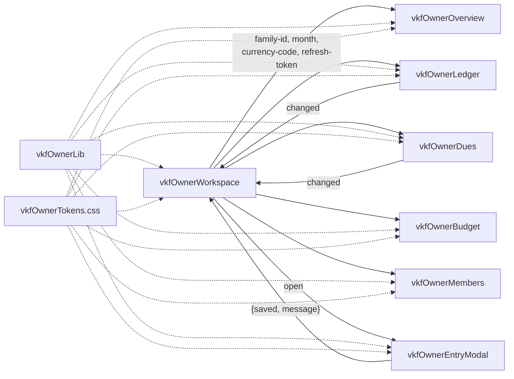

# Technical reference — Owner Workspace

## Controller API (`VkfOwnerController`)

Every method requires the `VKF_Platform_Admin` custom permission. None are `cacheable`: some reads seed default categories or generate card statements. Writes are refused for suspended families. Errors arrive as `AuraHandledException` with a user-facing message.

| Method                                                    | Parameters                                                                       | Returns (JSON string)                                                                   | Service                                                                    |
| --------------------------------------------------------- | -------------------------------------------------------------------------------- | --------------------------------------------------------------------------------------- | -------------------------------------------------------------------------- |
| `getFamilies()`                                           | —                                                                                | `FamilySummary[]`: `id, name, familyCode, status, currencyCode, memberCount, adminName` | `OwnerContext.families`                                                    |
| `getOverview(familyId, month)`                            | `month` `'YYYY-MM'`, blank = current                                             | `FinanceDtos.Dashboard`                                                                 | `DashboardService.build`                                                   |
| `getTransactions(familyId, filtersJson)`                  | JSON: `month, q, type, accountId, categoryId, memberId, cursor, limit` (max 200) | `FinanceDtos.TxnPage`: `items, totals, nextCursor`                                      | `TransactionService.listTransactions`                                      |
| `getEntryOptions(familyId)`                               | —                                                                                | `{ accounts, categories, members[{id,name,role}], paymentModes }`                       | Account, Category, Member services                                         |
| `saveEntry(familyId, entryJson)`                          | Entry body (below)                                                               | `FinanceDtos.Txn`, or `FinanceDtos.Transfer` for a transfer                             | `TransactionService.createTransaction` / `TransferService.createTransfer`  |
| `voidTransaction(familyId, transactionId)`                | —                                                                                | void                                                                                    | `TransactionService.voidTransaction` (both legs; re-opens paid bills/EMIs) |
| `getDues(familyId, days)`                                 | `days` 1–90, default 30                                                          | `CommitmentDtos.DueItem[]`                                                              | `DuesService.upcoming`                                                     |
| `payDue(familyId, kind, recordId, parentId, paymentJson)` | `kind` `bill` or `emi`; optional `{amount, accountId, date}`                     | Bill instance or loan                                                                   | `BillService.payInstance` / `LoanService.payEmi`                           |
| `getBudget(familyId, month)`                              | `'YYYY-MM'`                                                                      | `FinanceDtos.BudgetView`                                                                | `BudgetService.getBudget`                                                  |
| `getMembers(familyId)`                                    | —                                                                                | `PortalDtos.Member[]`                                                                   | `MemberService.listMembers`                                                |

### Entry body

| Type                | Fields                                                                                                                |
| ------------------- | --------------------------------------------------------------------------------------------------------------------- |
| `Expense`, `Income` | `type, amount, date (YYYY-MM-DD), accountId, categoryId`, optional `payee, paymentMode, memberId, notes, referenceNo` |
| `Transfer`          | `type: "Transfer", amount, date, fromAccountId, toAccountId`, optional `notes`                                        |

### Error messages

| Source                         | Message shown                                                                                                                                                                      |
| ------------------------------ | ---------------------------------------------------------------------------------------------------------------------------------------------------------------------------------- |
| `PortalException` with details | The service's own text (e.g. "Pay bills from a bank, cash, wallet or card account.")                                                                                               |
| `PortalException` code only    | `NOT_FOUND` → "That record no longer exists."; `CONFLICT` → "That record was changed. Refresh and try again."; `VALIDATION`, `BAD_REQUEST`, `NOT_AUTHORIZED` have similar defaults |
| Anything else                  | "Something went wrong. Please try again." (full detail in the debug log as `Owner Workspace error`)                                                                                |

## Owner context

```apex
UserContext ctx = OwnerContext.forFamily(familyId, /* forWrite */ true);
// ctx.role == 'Family Admin', ctx.familyId from the database,
// ctx.ownerUserId == UserInfo.getUserId(), ctx.sessionId == null
// AuditService.actingOwnerId is set for the rest of the request
```

Admin selection: the earliest-created **Active** Family Admin, otherwise the earliest **Invited** one. (Picklists sort in definition order, so the choice is made in Apex, not in `ORDER BY`.)

## Audit format

Events are unchanged except for the details prefix:

```text
Event_Type__c = TXN_CREATED
Actor_Id__c   = <family admin's Portal_User__c id>
Details__c    = [Owner 005xx0000012345] Expense 1250.00
```

Search the audit big object or the archive sheets for `[Owner ` to list every owner action.

## UI architecture



- **Loading.** Each section loads in its property setters. A sequence number keeps only the latest response when several setters fire together or the user switches quickly; the first render shows skeletons, later reloads keep the old data visible.
- **Refresh.** Sections fire `changed` after a void or payment; the shell bumps `refreshToken`, and the open section reloads.
- **Storage.** Only the last family and section are kept in `localStorage`, wrapped so blocked storage never breaks the page.

## Design tokens (`vkfOwnerTokens.css`)

| Token                                                                     | Value                                                                                                       | Use                                               |
| ------------------------------------------------------------------------- | ----------------------------------------------------------------------------------------------------------- | ------------------------------------------------- |
| `--vkf-brand` / `--vkf-brand-strong`                                      | `#0f4c5c` / `#0b3a46`                                                                                       | Console header colour; headings, active segments  |
| `--vkf-accent`                                                            | `#14b8a6`                                                                                                   | Progress, focus rings, income trend               |
| `--vkf-hero`                                                              | Teal gradient                                                                                               | Hero card, **+** button, primary buttons          |
| `--vkf-ink`, `--vkf-muted`, `--vkf-line`, `--vkf-canvas`, `--vkf-surface` | SLDS 2 hooks (`--slds-g-color-on-surface-*`, `border-1`, `surface-1`, `surface-container-*`) with fallbacks | Text, borders, backgrounds — follow the org theme |
| `--vkf-income` / `--vkf-expense` / `--vkf-warn` (+ `-soft`)               | Green / rose / amber                                                                                        | Money in, money out, due soon                     |
| `--vkf-radius`, `--vkf-radius-sm`, `--vkf-radius-pill`                    | 20 px, 12 px, pill                                                                                          | Cards, inputs, chips                              |

Shared classes: `card`, `card-title`, `chip` (`chip_good`, `chip_bad`, `chip_warn`), `row`, `avatar`, `segmented` / `segment`, `skeleton`, `bar-track` / `bar-fill`, `empty`, `num`, `fade-in`. Animations respect `prefers-reduced-motion`.

Layout is phone-first: single column with a 2-column KPI grid; 4 columns from 768 px; wider cards from 1200 px. The **+** button becomes icon-only under 480 px and sits above the phone's safe area.

## Testing

```bash
# LWC (repo root)
npx sfdx-lwc-jest -- --testPathPattern vkfOwner
npx eslint "force-app/main/default/lwc/vkfOwner*/**/*.js"

# Apex
sf apex run test --target-org VKFINANCE --class-names VkfOwnerControllerTest --code-coverage --wait 20
```

Jest needs two mappings in `jest.config.js`: `lightning/modal` (stub in `jest-mocks/`) and `c/vkfOwnerTokens` (CSS-only module). Base-component `name` values are properties, not attributes — find comboboxes by `el.name`, not `[name=…]`.

## Extending

**Add a section**

1. Create `lwc/vkfOwnerX` with `@api familyId / month / currencyCode / refreshToken` setters that call `load()`, copying the sequence-number pattern from an existing section.
2. Start its CSS with `@import 'c/vkfOwnerTokens';`.
3. Add it to `TABS` and the template in `vkfOwnerWorkspace`.

**Add a controller method**

1. Get the context with `OwnerContext.forFamily(familyId, isWrite)` — never build a `UserContext` yourself.
2. Call an existing service; don't put ledger logic in the controller.
3. Return `JSON.serialize(result, true)`; wrap the body in `try { … } catch (Exception e) { throw auraError(e); }`.
4. Don't expose services that need a portal session (`ctx.sessionId`) or step-up checks.
5. Add a test to `VkfOwnerControllerTest`, including the permission refusal.
